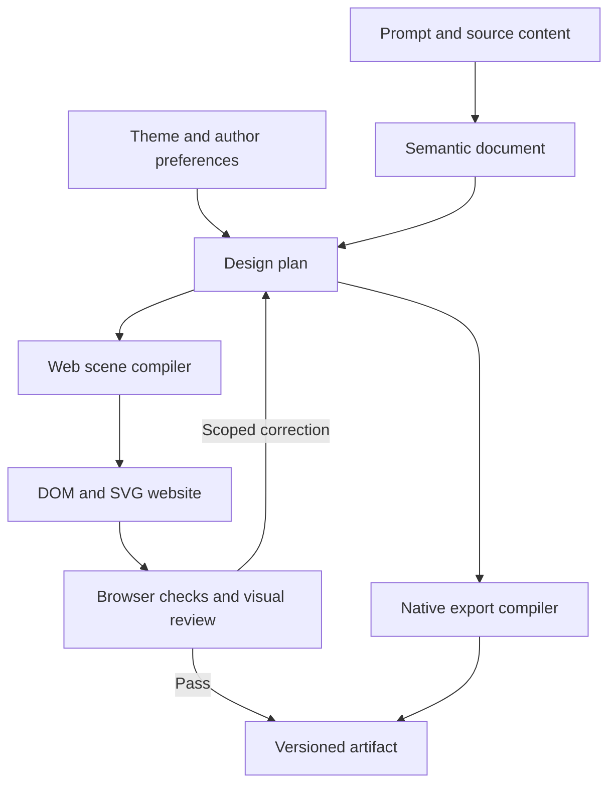

# DeckWeft — Visual-First Modular Build Roadmap

Date: 2026-10-18

Status: requirements and implementation plan reconciled with the local working tree on 2026-10-18. VIS-002–011 have recorded local implementations; VIS-001 has recorded clean-checkout and remote CI acceptance. VIS-012 is implemented locally with partial acceptance (Claude login/live task deferred). VIS-013 is implemented locally; VIS-014–016, SRC-001–007, DOC-001 and EXP-001 remain planned. These IDs are local roadmap records, not claims that GitHub issues exist. Local implementation does not establish host or release acceptance.

Audited baselines:

- DeckWeft: `9204f21161fd5b5c15c4040bd2414bed55fb4d99` (`0.1.0-alpha.2`).
- Open-Deck-Skill: `415727e9ea80d3fd8cea22c30c234577ce4cf2f3`.
- Read this together with the earlier integration blueprint for the wider source-synchronization architecture. This roadmap deliberately makes visual quality the first release gate.

## 0. Current implementation and remaining scope

The checked-out HEAD is still `9204f21161fd5b5c15c4040bd2414bed55fb4d99`; the substantial local changes are uncommitted. HEAD alone therefore does not identify the implemented application. Preserve this working tree, and use the source fingerprints in each evidence record when comparing outputs. The pinned audit below describes the earlier committed renderer. This reconciliation checks local source and existing receipts; it does not rerun external product documentation or authenticate either host.

| Tasks | Current local implementation | Evidence and remaining gate |
|---|---|---|
| VIS-001 | CI installs locked tools; three legacy baseline decks and capture harness exist. | [Wave A evidence](docs/evidence/visual-wave-a/review.md); [clean-checkout and three-platform CI acceptance is recorded](docs/evidence/interaction-visual-regression/publication.json). |
| VIS-002–005 | Strict v3 semantic/design/WebScene contracts, explicit legacy copy migration, revisioned Visual Studio, three versioned theme packs and scoped locks. | [Studio evidence](docs/evidence/visual-studio/review.md); local scope only. |
| VIS-006 | Six families × three geometric candidates, measured selection, whole-deck rhythm and stable reorder. | [Composition evidence](docs/evidence/vis-006/review.md); six further families are required before VIS-014. |
| VIS-007 | Local original PNG/JPEG/WebP retention, derivatives, saved-document image extraction, named slots and author-protected crops. | [Asset evidence](docs/evidence/vis-007/review.md); arbitrary PPTX/PDF extraction, detected subjects and v3 generation transport remain open. |
| VIS-008–009 | Six typed chart variants, directed diagrams, exact code, annotations, real audience state and deterministic cues. | [Component evidence](docs/evidence/vis-008/review.md), [interaction evidence](docs/evidence/vis-009/review.md); native v3 compilation and wider accessibility/engine coverage remain open. |
| VIS-010 | Real browser diagnostics, image-bound review receipts and bounded composition repair. | [Quality evidence](docs/evidence/vis-010/review.md); representative tests do not close exhaustive state or release acceptance. |
| VIS-011 | Seven shared tools, local task checkpoints, scoped chart/composition revisions and reviewed HTML/recovery exports. | [Task evidence](docs/evidence/vis-011/review.md); supplied-text planning is deterministic, rich host drafting remains open. |
| VIS-012 | Thin local host adapters, probes, bounded transport and shared drafting/patch/image-review routes. | [Host evidence](docs/evidence/vis-012/review.md); Claude login/live acceptance deferred, overall partial. |
| VIS-013–014 | VIS-013 is implemented locally. VIS-014 is **partial** (2026-10-19): frozen bilingual gallery, three bilingual 8-page stories, explicit cases, legacy comparison, standalone exports in three engines and a real Codex task with a scoped revision ([evidence](docs/evidence/vis-014/review.md)). | Claude is deferred; missing-glyph detection, the 390 px heatmap, CJK heading breaks, payload size and author calibration of the below-threshold review remain open. |
| VIS-015/016, SRC-001–007, DOC-001, EXP-001 | Planned extensions; existing source records, jobs, native v1/v2 exports and spatial demos are reusable foundations. | Do not infer completed synchronization, v3 native output or living documentation from those foundations. |

Current source boundaries are `src/agent/` (director/tools/revisions), `src/design/` (themes/compositions/rhythm), `src/components/`, `src/motion/`, `src/scene/web/`, `src/render/web/`, `src/quality/`, `src/services/visual-api.mjs`, `src/services/visual-store.mjs` and `public/studio/`. The legacy contract remains `schemas/project.schema.json`; v3 uses `presentation-v3`, `design-plan`, `web-scene` and `visual-project` schemas. `src/targets/capabilities.mjs` explicitly refuses unsupported native v3 targets.

### Next reviewable implementation slices

1. **VIS-012 (local implementation present; acceptance partial):** reuse the seven shared tools and current packaging; implement thin capability/parsing adapters and secret-free receipts. Probe only what is observable; do not infer subscription/billing/authentication from installed binaries. Validate actual image delivery and final structured artifacts independently in each authorized host. Claude authentication remains deferred; finish independent adapter work without bypassing that gate.
2. **VIS-013:** connect the existing Visual Studio to the shared task loop and adapters. Persist prompt/output/UI language and scoped design choices separately. Retain checkpoint conflicts, locks, last-valid recovery and private-note boundaries.
3. **VIS-014 preparation and gate:** add the six remaining composition families, frozen bilingual 12-page gallery and coherent 8-page story per theme; compare against the legacy baseline. Reuse VIS-010 capture/review, then require both actual host runs and a standalone package outside the repository. Keep remote CI and manual accessibility/application checks separately visible.
4. **Later scope:** additional themes, target-specific editable v3 exports, local source extraction/jobs/publication, then demand-led connectors and code documentation. Cloud connectors and scheduled publication require separate authorization and opt-in configuration; this document does not authorize remote upload or background jobs.

`roadmap.json` is the task/status/dependency source of truth; [ROADMAP.md](ROADMAP.md) and its [Chinese edition](docs/zh-CN/roadmap.md) summarize it. `executionOrder` records the earlier implemented batch; `nextExecutionOrder` records planned work and grants no execution permission. Historical evidence remains unchanged.

## 1. Product outcome and first release contract

Build a prompt-first studio that turns English or Chinese instructions, existing documents, and an author's design preferences into a visually distinctive, playable website. The web output should combine strong typography, large imagery, expressive color, structured diagrams, real charts, and useful interaction. The studio shell may remain calm and restrained; published presentations have their own independent art direction.

The first meaningful release delivers:

1. Three executable visual systems: **Cream Collage**, **Electric Violet**, and **Dark Data**.
2. A fixed 12-page regression gallery across those three systems, in English and Simplified Chinese.
3. One coherent 8-page story per system, also in both languages. A gallery tests individual pages; complete stories test pacing and consistency.
4. Six initial composition families with three materially different variants each, then six additional families for the release gate.
5. Real image selection/cropping, data-driven charts, diagrams, and at least three working interaction types.
6. One-prompt generation and scoped revision through both Codex and Claude Code, each backed by an actual host run receipt.
7. A real browser-rendering, screenshot-inspection, and bounded correction loop.

Hourly synchronization and additional connectors follow this release. They reuse the same semantic document, design plan, source IDs, and publication interfaces. An automated publisher needs an excellent renderer to publish into.

“Kimi K3-like quality” is an experience reference, not a measurable guarantee supplied by a model name. Kimi's official pages describe custom styles, image/reference input, charts and diagrams, presentation refinement, and visual knowledge-work outputs [K1–K2]. Those statements do not reveal a private slide-generation implementation. The pipeline proposed here is an engineering design inferred from the capabilities needed to produce the desired experience.

## 2. Historical audit: why the committed baseline converged on similar pages

| Baseline code | Audited behavior | Requirement addressed by the local v3 path |
|---|---|---|
| `src/layout/engine.mjs` | v2 chooses a one-element candidate list; `auto` becomes `editorial`. | Separate a semantic family from its geometric candidates; compare real alternatives. |
| `src/layout/scene.mjs` | v2 returns `compileRecipe()` before the `cosmos-dots` showcase branch. | Integrate expressive composition capabilities into the normal compiler. |
| `src/layout/recipes.mjs` | Most families share title/body coordinates; comparison and metric both use `cards()`; metrics become strings. | Preserve typed data and provide distinct reading paths, scales, and compositions. |
| `src/layout/showcase.mjs` | Richer visuals depend on `i % 14`, fixed assets, and a fixed 16:9 canvas. | Extract reusable compositions; bind style to explicit design plans rather than slide position. |
| `src/layout/scene.mjs`, `src/render/svg.mjs` | Four palettes and a narrow text/rect/ellipse/image vocabulary. | Add versioned theme packs and a richer web scene protocol. |
| `src/render/html.mjs`, `src/render/player.mjs` | Main content is fixed-canvas SVG; animation sequencing largely uses SVG group order; tabs/steps mostly dim other groups. | Use semantic DOM plus SVG graphics and explicit state/event/timeline contracts. |
| `src/assets/generation.mjs` | Attaching a generated image sets `image-caption`, clears spatial rendering, and replaces interaction with `none`. | Attach an asset to a named slot without destroying unrelated design intent. |
| `.github/workflows/ci.yml` | The audited Actions run fails before tests because TypeScript is missing; dependency installation is absent. | Run `npm ci` before verification and obtain a successful remote run. |

The table describes the pinned baseline, not the current v3 path. In the working tree, `generation.mjs` preserves spatial/interaction intent and CI runs `npm ci`; the semantic renderer, component registry and candidates address the other limitations without replacing legacy rendering defaults. These historical claims are grounded in the pinned repository sources [D1–D9] and the recorded failed Actions run [D10]. They are not claims that the complete application was newly executed in both coding hosts during this review.

Keep the existing strengths: validation, revision checks, atomic storage, history, font-aware browser measurement, source-bound hashes, and native export structure. Open-Deck contributes design knowledge, useful export/provenance techniques, and local PPTX components. Its Markdown theme library needs compilation into executable rules. Its current remote Kimi editor integration does not provide ownership of Kimi's renderer [O1–O3].

## 3. Architecture and module boundaries

Keep the existing ESM core. A framework migration is not a prerequisite for visual improvement. New modules can use `.mjs` with the repository's existing type-checking conventions.



### 3.1 Canonical records

| Record | Owns | Must not become |
|---|---|---|
| `SourceSnapshot` | Source identity, version/hash, anchors, permissions, extracted blocks | A prompt with authority to change job permissions |
| `PresentationDocument` | Facts, text, typed chart data, references, code and stable block IDs | A set of HTML fragments |
| `VisualBrief` | Audience, output language, mood, intensity, reference preferences, asset budget | A replacement for factual source material |
| `DesignPlan` | Scene roles, content bindings, compositions, focal points, assets, cues | A second editable copy of facts and numbers |
| `AuthorOverrides` | Explicit locks and scope-specific style/content choices | An unscoped append-only prompt history |
| `WebScene` | Derived DOM/SVG regions, reading order, interactive state bindings | The universal lowest common denominator for every export |
| `NativeScene` | Target-specific editable objects and supported static fallbacks | A screenshot reconstruction of the web page |
| `RunReceipt` | Input/theme/renderer hashes, tool evidence, output hashes, QA results | A self-reported “looks great” message |

Use stable logical IDs plus content hashes. A document edit changes the content hash, not necessarily the logical block ID. Animation targets, author locks, URLs, and source dependencies depend on stable identity.

### 3.2 Architectural interface sketch

The following remains an architectural sketch, not an importable public API. Reuse the current functions in the modules listed in section 0. Host/source interfaces remain planned:

```ts
type CompileContext = {
  document: PresentationDocument;
  plan: DesignPlan;
  overrides: AuthorOverrides;
  theme: ResolvedTheme;
  assets: AssetManifest;
  locale: string;
};

interface DesignEngine {
  propose(context: CompileContext): Promise<CandidateSet>;
  select(candidates: CandidateSet, rhythm: DeckRhythm): DesignPlan;
}

interface RenderTarget {
  capabilities(): TargetCapabilities;
  compile(context: CompileContext): TargetScene;
  audit(scene: TargetScene): TargetAudit;
  export(scene: TargetScene): Promise<ArtifactManifest>;
}

interface HostAdapter {
  probe(): Promise<CapabilityReceipt>;
  run(request: AgentRunRequest): Promise<RunReceipt>;
}

interface SourceAdapter {
  listChanges(cursor?: string): Promise<ChangePage>;
  fetchSnapshot(sourceId: string, version?: string): Promise<SourceSnapshot>;
  normalize(snapshot: SourceSnapshot): Promise<NormalizedSource>;
}
```

### 3.3 Migration rules

- Preserve v1/v2 readers and rendering defaults. Add v3 behind an explicit format/feature gate.
- Validate each legacy version before adapting it. Preserve unrecognized extensions in migration metadata; never drop them silently.
- Existing source JSON is not rewritten by simply viewing a project. Migration creates a new revision or explicit copy with a source hash.
- Share content checks across targets. Apply layout, interaction, performance, and native-editability checks in their corresponding target compilers.
- Preserve typed numbers through every compiler. Do not flatten chart data to presentation strings and later parse the strings back.
- Retain common data/diagram semantics while allowing richer web behavior and separately reported static/export fallbacks.

## 4. Visual systems to build

The colors below are initial tokens extracted from the theme documents; some source values are approximate. Font names are preferences requiring a packaged/available-font check. They are not evidence that a font is bundled or licensed with the repository [O4–O9].

| Wave | Profile | Initial palette | Executable visual identity | Useful web interaction |
|---|---|---|---|---|
| First | `cream-collage` | Cream `#F3E8D4`, tomato `#F05A39`, cobalt `#2657D7`, ink `#171717` | Diagonal planes, hard edges, oversized numbers, asymmetric editorial typography | Diagonal reveals, chapter jumps, comparison states |
| First | `electric-violet` | Violet `#5114F6`, white, near-black `#121212` | Large real photography, 44/56 or 38/62 splits, full-color chapter pages | Photo detail, case switching, before/after comparison |
| First | `dark-data` | Black `#080808`, green `#A6F05F`, violet `#7A54FF`, pink `#F19EE2` | Large multi-series charts, vivid annotations, stable semantic series colors | Time-range controls, shared cursor, legend filtering |
| Second | `silver-gray-editorial` | White/black, copper `#9D5A37`, limited gold | Full-bleed documentary photography, serif headlines, visual negative space | Image detail and evidence views |
| Second | `fresh-report` | Light green `#C3F0C9`, dark green `#00634F`, pink `#FFCDD2`, lavender `#CDB8E3` | Flat illustration, varied chapter color fields, structured report navigation | Search, deep links, evidence disclosure, update markers |
| Second | `orange-launch` | Near-black `#1D1D1D`, orange `#FC7C3D`, pale orange `#FECEAA` | Product reveal, oversized typography, localized light effects, contrasting proof pages | Feature hotspots, product detail, progressive reveal |

`orange-launch` is a proposed derivative of the source `orange-tech` business-report theme, not an existing complete launch system. Store its parent and explicit overrides.

Theme packs must define palette roles, English/Chinese typography roles, spacing, image treatments, composition preferences, chart colors, motion vocabulary, and per-scene color modes. Merely assigning a new `accent` is insufficient.

### Scope design rules instead of collecting global prohibitions

Open-Deck's source themes contain legitimate differences: Fresh Brand uses parallel cards, Dark Data uses fluorescent colors, photography systems require negative space, and data-heavy consulting styles often discourage these choices. Store rules with `theme`, `sceneRole`, `contentRelation`, `mode`, `severity`, and `rationale`.

Apply current user intent within content-accuracy and functional constraints, then project preferences, scene role, composition rules, and defaults. A rule like “no generic cards” can apply to one profile; it should not suppress useful parallel cards in another. Constraints such as readable required text, accurate numeric values, and traceable evidence apply across themes.

## 5. Task requirements and acceptance criteria

The specifications below retain the full target requirements, including already implemented parts. Apply section 0 and `roadmap.json` before starting work; imperative wording here does not mean every module needs rebuilding.

Priority indicates product order. Dependencies indicate merge/runtime prerequisites. A task may begin against a frozen contract before every dependency is merged, but it cannot be marked complete without integration evidence. S/M/L are relative implementation sizes, not promised dates.

### VIS-001 — Reproducible baseline and working CI

Current state: **implemented-local, baseline/CI acceptance recorded**. Clean committed source installs and passes verification locally and on three remote platforms; see section 0 and `roadmap.json`.

**P0 · S · Dependencies: none**

Modify `.github/workflows/ci.yml` to install locked dependencies with `npm ci` before `npm run verify`. Confirm the lockfile and current main before editing. Add `tests/fixtures/visual/`, `scripts/capture-visual-baseline.mjs`, and `docs/visual-baseline/`. Keep snapshot artifacts outside ordinary source fixtures when large.

Capture the current renderer with fixed content: an English product narrative, Chinese research/strategy material, and technical documentation containing code and API tables. Record commit, fonts, viewport, browser, source hashes, and output hashes. The capture harness can start with one browser and expand only where needed.

**Acceptance:** clean checkout installs and passes the existing verify chain locally and remotely; current-state screenshots are reproducible; errors encountered before tests are accurately distinguished from test failures. This task creates the first trustworthy comparison, not a claim of improved design.

### VIS-002 — Semantic document, design plan, and v3 adapter

Current state: **implemented-local**. See section 0 and `roadmap.json` for scope and remaining acceptance.

**P0 · L · Dependencies: VIS-001**

Modify `src/core/model.mjs`, `validate.mjs`, `migrate.mjs`, `src/planning/storyboard.mjs`, and schema routing. Add `schemas/presentation-v3.schema.json`, `schemas/design-plan.schema.json`, `src/contracts/`, `src/core/blocks.mjs`, and `src/core/adapters/legacy-project.mjs`.

Support typed heading, paragraph, list, quote, metric, table, chart, diagram, code, image, callout, and citation blocks initially. Reserve explicit API-symbol/video support for later extensions. Preserve values, units, datasets, locale, source anchors, stable IDs, and author overrides. Keep derived scenes out of canonical editable facts.

**Acceptance:** old fixtures still load/render; migration does not mutate old files; a numeric chart, long Chinese heading, code sample, and source citation survive a round trip without flattening or data loss. Revision conflicts remain enforced.

### VIS-003 — Web scene and target capability contracts

Current state: **implemented-local**. See section 0 and `roadmap.json` for scope and remaining acceptance.

**P0 · M · Dependencies: VIS-002**

Add `schemas/web-scene.schema.json`, `src/scene/web/validate.mjs`, `src/targets/capabilities.mjs`, and shared scene interfaces. Update export routing in `src/render/export.mjs` so target validation happens after target selection.

Define stable node IDs, groups, regions, text roles, SVG paths, transforms, clipping, gradients, image crops, semantic links, data/component bindings, reading order, and breakpoint variants. Define interaction targets by stable ID. The scene references registered components and data rather than carrying arbitrary executable source text.

**Acceptance:** a collage page with diagonal geometry, a photographic page with a safe crop, and a chart page with a semantic data binding validate. An unsupported PPTX effect creates a PPTX-specific capability result and does not block valid web output.

### VIS-004 — Semantic DOM/SVG renderer and bilingual layout

Current state: **implemented-local**. See section 0 and `roadmap.json` for scope and remaining acceptance.

**P0 · L · Dependencies: VIS-003**

Add `src/scene/web/compile.mjs`, `src/render/web/document.mjs`, `src/render/web/components/`, and a corresponding runtime entry. Integrate existing `src/layout/text.mjs`, `public/text-measurer.js`, and measurement receipts.

Render headings, paragraphs, lists, code, tables, and controls as semantic HTML. Use SVG for precise graphics; retain raster imagery as assets. Presentation mode preserves intended slide composition, while reading mode reflows content. Measure the actual DOM text style after fonts are ready; Canvas remains useful for candidate estimation but is not sufficient for every rich-text/HTML layout.

**Acceptance:** desktop play mode and 390 px reading mode work from the same document; CJK and English use appropriate fonts, weights, and line breaks; required content is readable with JavaScript disabled; screenshots and fit reports refer to the same render hash. Audit text on photos/gradients, not just `ink` versus page background.

### VIS-005 — Theme packs and author profiles

Current state: **implemented-local**. See section 0 and `roadmap.json` for scope and remaining acceptance.

**P1 · M · Dependencies: VIS-002**

Add `schemas/theme-pack.schema.json`, `src/design/tokens.mjs`, `profile.mjs`, `theme-registry.mjs`, and `themes/cream-collage/`, `electric-violet/`, `dark-data/`. Adapt `src/core/preferences.mjs` without coupling studio UI styling to presentation styling.

Import the relevant Open-Deck rules into curated, source-attributed tokens and scoped constraints. Define semantic color roles, per-section color modes, display/body/code/data typography, image grammar, density ranges, and motion preferences. Persist author choices such as bold color, photographic emphasis, editorial headlines, and scene-specific locks.

**Acceptance:** changing theme alters typography, composition preferences, image treatment, and pacing as well as color. Contradictory rules resolve by scope. Source design documents and derivative changes are traceable; required fonts have validated fallbacks.

### VIS-006 — Compositions, candidates, and full-deck rhythm

Current state: **implemented-local**. See section 0 and `roadmap.json` for scope and remaining acceptance.

**P1 · L · Dependencies: VIS-004, VIS-005**

Modify `src/layout/engine.mjs`, `recipes.mjs`, `showcase.mjs`; add `src/design/compositions/`, `candidates.mjs`, `deck-rhythm.mjs`, and `scorecard.mjs`.

Begin with six families: statement, photographic story, oversized metric, data evidence, comparison, and process. Give each three geometrically different variants. Expand to quote, case study, annotated product, chapter, technical explanation, and closing before VIS-014. Extract reusable showcase ideas without keeping page-index-dependent styling.

Generate feasible candidates, reject unreadable ones, and choose across the whole story. Track focal point, visual-medium distribution, density, color mode, and repetition. A series of comparable plots may deliberately repeat; unrelated pages should not accidentally share an identical silhouette. Store decisions and overrides.

**Acceptance:** representative content has three candidates with materially different geometry/reading paths; at least two survive fit checks; reordering a scene does not silently change its theme. No loss of facts to improve a layout score. Candidate diversity is checked through geometry and visual review, not only different IDs.

### VIS-007 — Asset direction, source extraction, and safe cropping

Current state: **implemented-local**. See section 0 and `roadmap.json` for scope and remaining acceptance.

**P1 · L · Dependencies: VIS-004, VIS-005**

Extend `src/assets/registry.mjs`, `generation.mjs`, and `src/render/assets.mjs`; add `src/assets/brief.mjs`, `slots.mjs`, `selection.mjs`, `crop.mjs`, and `providers/`. Retain content hashes, provenance, caching, and bounded resource budgets.

Represent asset role, required quality, focal point, safe region, crop variants, source reference, factual/decorative status, and available generation backend. Reuse original document images and product screenshots. Support validated JPEG/WebP derivatives for efficient web photography while retaining native-target-compatible assets. Select images before finalizing photograph-led compositions.

Attach assets to named slots without replacing the scene family, clearing interactions, or mutating unrelated author choices. A task's recorded tool/asset allowance can support automatic internal steps; ambiguous charged requests remain idempotent/recoverable.

**Acceptance:** a product image changes without destroying the scene; portrait/wide crops preserve a protected subject; asset reuse avoids duplicate generation; unavailable image generation produces an honest capability result and a deliberate alternative composition. Generated concepts never masquerade as historical screenshots or source evidence.

### VIS-008 — Charts, diagrams, code, and annotation components

Current state: **implemented-local**. See section 0 and `roadmap.json` for scope and remaining acceptance.

**P1 · L · Dependencies: VIS-004, VIS-006**

Add `src/components/charts/`, `diagrams/`, `code/`, and `annotations/`; integrate typed blocks and theme tokens. Start with line/area, ranked bar, stacked comparison, scatter, and matrix/heatmap only where the benchmark needs them. Start diagrams with node/edge, sequence, and annotated process structures.

Each component provides web rendering, measurement, accessible data/text representation, static fallback, and target capability metadata. Charts consume numeric tables with explicit units, axis policies, time zones where relevant, and source references. Treat code as exact text with emphasized lines and source anchors.

**Acceptance:** changing data changes chart marks, labels, legends, and accessible tables consistently; negative/zero/missing values are handled deliberately; diagrams express supplied relationships; code text survives export. Charts and explanatory labels stay editable/semantic rather than being embedded in generated illustrations.

### VIS-009 — Semantic motion and real interactive state

Current state: **implemented-local**. See section 0 and `roadmap.json` for scope and remaining acceptance.

**P1 · L · Dependencies: VIS-004, VIS-006, VIS-008**

Refactor `src/render/player.mjs` and `html.mjs`; add `src/motion/cues.mjs`, `timeline.mjs`, `policies.mjs`, and `public/runtime/` modules. Reuse existing spatial modules behind optional component capabilities.

Define `scene.enter`, `scene.exit`, `step.next`, `tab.select`, `data.filter`, and `annotation.reveal`. Cues refer to stable node IDs and meaningful event order. Initial interactions: chart range/series selection, image comparison or hotspots, and stepwise diagram/code explanations. Clicking a control must change relevant state/data/view rather than only dimming unrelated content.

**Acceptance:** keyboard, touch, and mouse flows work; reduced-motion preserves information and operation; hidden scenes release timers, media, and GPU resources; entering/replaying/seeking produces deterministic state. Offline output contains its required runtime and assets. Scene reordering does not retarget effects.

### VIS-010 — Browser QA and bounded visual correction

Current state: **implemented-local**. See section 0 and `roadmap.json` for scope and remaining acceptance.

**P1 · L · Dependencies: VIS-004, VIS-009**

Extend VIS-001's renderer harness with `src/quality/render-checks.mjs`, `visual-review.mjs`, `repair-plan.mjs`, `scripts/visual-verify.mjs`, and `tests/visual-*.test.mjs`. Keep tests discoverable by the current test script or explicitly update discovery.

Produce a contact sheet, full-resolution scene captures, font/resource/console diagnostics, text and source coverage reports, and interaction traces. The reviewing model must actually receive image input. Structured issues include scene/node IDs, bounding boxes, severity, rationale, and suggested changes. Repair only affected plans/slots/regions, with a default maximum of two automatic repair rounds and a configurable budget.

**Acceptance:** deliberately inserted clipping, white-on-white text, missing assets, duplicate compositions, and broken interactions are detected by the appropriate check. Modified content invalidates old receipts. A screenshot hash alone is not proof of visual review; record image delivery and the review result. If quality remains below the gate, keep the last valid artifact and report the incomplete candidate.

### VIS-011 — Design director and one-task production loop

Current state: **implemented-local**. See section 0 and `roadmap.json` for scope and remaining acceptance.

**P1 · L · Dependencies: VIS-006, VIS-007, VIS-008, VIS-009, VIS-010**

Extend `src/planning/storyboard.mjs`, `src/services/agent-bridge.mjs`, and `src/adapters/agent-mcp.mjs`; add `src/agent/design-brief.mjs`, `director.mjs`, `tools.mjs`, and `revision-plan.mjs`.

Expose one common tool surface: `content.inspect`, `design.propose`, `assets.resolve`, `render.preview`, `render.inspect`, `design.patch`, and `artifact.export`. These seven names are now implemented in `src/agent/director.mjs` and dispatched by `src/agent/tools.mjs`. The director selects a story arc, scene roles, focal points, composition variants, color modes, and asset requirements before compiling. Use theme excerpts relevant to the task rather than loading every design document into each prompt.

Run factual/content checks, real rendering, image-based review, scoped corrections, and final artifact checks within the original task's authorized scope. Task-state transitions should let routine internal work proceed without repeated GUI confirmations, while preserving revision and tool-scope checks. Return the finished artifact and meaningful exceptions, not a mandatory tour through internal stages.

**Acceptance:** a natural-language request produces a complete story and a precise revision such as “make scene 4 a chart; keep wording and colors” changes only that scope. The director does not generate made-up evidence or silently remove locked content to improve appearance.

### VIS-012 — Codex and Claude Code adapters with capability probes

Current state: **partial**; local adapter implementation and tests exist. Claude login/live task remain deferred. [Manual](docs/en/hosts.md) · [Evidence](docs/evidence/vis-012/review.md). See section 0 and `roadmap.json` for scope and remaining acceptance.

**P1 · M · Dependencies: VIS-002, VIS-010, VIS-011**

Add `src/hosts/codex.mjs`, `claude-code.mjs`, `capabilities.mjs`, and `run-receipt.mjs`. Extend the existing doctor command and the canonical `skills/deck/` entry with thin host-specific packaging. Verify actual repository packaging paths before editing; these new path names are proposals.

Probe CLI version, execution surface, configured authentication/billing route, structured output, image input, renderer access, DOM diagnostics, image backend, writable scope, and timeout behavior. Unknown capabilities remain unknown. Use process argument arrays and controlled working directories. Do not interpolate user prompts into shell commands.

Codex final structured output and its JSONL event stream are different formats. Claude's schema result is in `structured_output`, not the entire JSON envelope. Keep one shared design implementation and host-specific parsing/loading only [H1–H2].

**Acceptance:** each real host independently produces validated artifacts and passes image-feedback delivery. An installed skill or successful mock test does not establish host acceptance. Package/install the plugin into a clean test environment and verify that themes, schemas, runtime files, fonts/assets, and scripts are included. No silent fallback from a user's selected host/model or subscription route to a separately charged API.

### VIS-013 — Prompt-first workbench and persistent design choices

Current state: **implemented-local**, with actual UI/Codex image-reviewed scoped revision and HTML export evidence in `docs/evidence/vis-013/review.md`. Claude stays deferred; VIS-014 remains open. See section 0 and `roadmap.json` for scope and remaining acceptance.

**P1 · M · Dependencies: VIS-011, VIS-012**

Modify `public/app.js`, `index.html`, `styles.css`, `workspace.css`, `storyboard.js`, and `agent-bridge.js`. Add focused `public/studio/` modules for prompt, preview, profile, and revisions rather than expanding a monolithic controller.

Primary flow: enter an English/Chinese prompt or choose a source, generate, watch the finished artifact, and revise in natural language. Advanced controls reveal profile, color intensity, asset emphasis, composition locks, and update preferences. Persist UI language, prompt language, output language, content tone, and visual style separately.

An author can say “keep these facts; use electric-violet photography; let the data section become dark; preserve slide 3's image.” Store typed overrides and their scope. A one-off scene instruction does not permanently overwrite the project-wide profile.

**Acceptance:** normal generation and revision require no manual layout edits; explicit author locks survive theme changes and source updates; references can remain public while private speaker notes stay private. The output website contains audience navigation, not editor chrome.

### VIS-014 — First visual release gate

Current state: **partial** (2026-10-19). Gate manual and records in `docs/visual-acceptance/`; evidence in `docs/evidence/vis-014/review.md`. See section 0 and `roadmap.json` for what remains.

**P1 · M · Dependencies: VIS-005 through VIS-013**

This is an integration gate, not a new production subsystem. Add `docs/visual-acceptance/`, the fixed gallery manifest, complete-story cases, and host receipts. Extend build/package checks where needed.

**Acceptance:** all three initial themes pass the bilingual 12-page gallery; each theme produces a coherent bilingual 8-page story; at least three interaction types work; both actual hosts finish a prompt-to-artifact task and a scoped revision; the standalone exported package works outside the repository. Compare the same content against VIS-001's baseline. Approve the whole story, including weakest pages, not only selected hero screenshots.

The first six composition families may ship as a development preview. The release gate requires the twelve-family breadth and documented exceptions for story-specific repetition. Do not delay this gate for cloud connectors, complete native chart export, or advanced 3D.

### VIS-015 — Additional styles and reference-guided personalization

Current state: **planned**. See section 0 and `roadmap.json` for scope and remaining acceptance.

**P2 · M · Dependencies: VIS-014**

Add `themes/silver-gray-editorial/`, `fresh-report/`, and `orange-launch/`, plus `src/design/reference-profile.mjs`. Capture palette, type contrast, image ratio, density, and composition preferences from supplied reference material, then map to supported tokens and recipes. Preserve attribution and derivative overrides.

**Acceptance:** extend the gallery with two pages per new direction and validate a full story in each. A reference-derived theme changes structure and visual grammar, not just colors. Author feedback can promote a successful design into a reusable profile without importing unrelated reference text or branding.

### VIS-016 — Target-specific editable exports

Current state: **planned**. See section 0 and `roadmap.json` for scope and remaining acceptance.

**P2 · L · Dependencies: VIS-003, VIS-008, VIS-014**

Extend `src/render/pptx.mjs`, `export.mjs`, and `src/adapters/handoff.mjs`; add `src/targets/pptx/compile.mjs`, `fallbacks.mjs`, `audit.mjs`, and `compatibility-report.mjs`.

Compile from semantic content/design into native text, supported charts, shapes, connectors, images, and notes. Build clear fallback policies for masks, interactive states, advanced effects, and spatial scenes. Reuse appropriate Open-Deck native/provenance ideas through a documented adapter rather than merging two incompatible project formats.

**Acceptance:** supported text/data remain editable; unsupported elements have explicit per-element receipts; no whole-slide screenshot is presented as a fully editable export. Validate in the actual target application where that compatibility is claimed. The rich web output remains available even when a different target requires a limited fallback.

### SRC-001 — Source snapshots and stable content extraction

Current state: **planned**. See section 0 and `roadmap.json` for scope and remaining acceptance.

**P2 · M · Dependencies: VIS-002, VIS-014**

Add `src/sources/contract.mjs`, `snapshots.mjs`, `extractors/`, and `lineage.mjs`. Begin with local Markdown/text, then document formats based on the actual users' source mix. Preserve original images, section/block identity, references, tables, and revision hashes. OCR is a separately reported extraction path.

**Acceptance:** rename, move, small edit, and deletion are distinguishable; unchanged logical blocks retain IDs; every published claim/graphic can link to source anchors. Extraction quality is reported before generation. A content hash supplements logical identity rather than replacing it.

### SRC-002 — Durable incremental jobs

Current state: **planned**. See section 0 and `roadmap.json` for scope and remaining acceptance.

**P2 · L · Dependencies: SRC-001, VIS-010, VIS-012**

Add `src/jobs/queue.mjs`, `leases.mjs`, `retries.mjs`, `change-plan.mjs`, and persistent storage. A local durable database is a reasonable first implementation; choose a managed queue only when deployment requires it. Define source-to-block-to-scene dependencies and run idempotency keys.

Do not reuse the current capped in-memory/whole-JSON bridge history as the production scheduler. Jobs bind immutable source snapshots and a base publication revision. Event notifications accelerate updates; periodic reconciliation catches missed events. No semantic change means no model call and no new publication.

**Acceptance:** restart recovery, duplicate events, partial downloads, retries, expired credentials, stale workers, and out-of-order completion do not corrupt or duplicate publication. History retention and garbage collection are explicit. Locks and unchanged assets remain intact through incremental rebuilds.

### SRC-003 — Local hourly publication and version history

Current state: **planned**. See section 0 and `roadmap.json` for scope and remaining acceptance.

**P2 · M · Dependencies: SRC-002, VIS-013**

Add `src/sources/local/`, `src/publication/versions.mjs`, `commit.mjs`, and `rollback.mjs`. Connect an authorized local folder, schedule reconciliation, build a candidate revision, run the visual gate, then atomically update the stable publication pointer. Provide a source-change summary and last-success/next-check status.

**Acceptance:** editing one source changes only affected scenes plus necessary neighboring context; unchanged scene IDs/assets remain stable; a failed build leaves the last successful website available; rollback restores a known version. An older job cannot overwrite a newer source revision. Public references and private notes remain separate.

An hourly poll detects a just-after-poll edit almost 60 minutes later; generation/publication adds more latency. To promise an update within 60 minutes under an online service objective, reserve processing time by polling more frequently or using events, and budget queue/build time. A sleeping local machine cannot meet an always-on promise. Show honest freshness and delay status.

### SRC-004 — Google Drive adapter

Current state: **planned**. See section 0 and `roadmap.json` for scope and remaining acceptance.

**P2 · M · Dependencies: SRC-003**

Add `src/sources/google-drive/`. Implement the shared change/snapshot contract, folder membership, native-document export, pagination/cursor persistence, deletion handling, and permissions. Consult current official Drive documentation during implementation [S1].

**Acceptance:** folder rename/move, edited native documents, duplicates, deletion, revoked access, and missed notifications converge to the correct snapshot set. The adapter produces sources; it does not implement a separate design engine.

### SRC-005 — Notion adapter

Current state: **planned**. See section 0 and `roadmap.json` for scope and remaining acceptance.

**P2 · M · Dependencies: SRC-003**

Add `src/sources/notion/`. Normalize pages and nested blocks, pagination, attached assets, update signals, and access changes through the shared contract. Check current official API/version behavior before coding [S2].

**Acceptance:** nested-block changes and deleted/archived/inaccessible content are reconciled without duplicating pages; linked evidence remains resolvable; webhook support, where used, is paired with reconciliation.

### SRC-006 — Dropbox adapter

Current state: **planned**. See section 0 and `roadmap.json` for scope and remaining acceptance.

**P2 · M · Dependencies: SRC-003**

Add `src/sources/dropbox/`. Normalize cursor-based folder changes, content retrieval, moves/deletions, and source metadata through the shared adapter contract. Use current official documentation [S3].

**Acceptance:** many-file pagination, interrupted cursor handling, identical names in different folders, and revoked access cannot leak one source's content into another. Use the existing incremental compiler and publisher.

### SRC-007 — OneDrive adapter

Current state: **planned**. See section 0 and `roadmap.json` for scope and remaining acceptance.

**P2 · M · Dependencies: SRC-003**

Add `src/sources/onedrive/`. Implement Microsoft Graph drive-item retrieval, delta/reconciliation, native-file handling where relevant, and folder authorization boundaries [S4].

**Acceptance:** personal/business deployment differences are explicitly tested for the supported account type; delta continuation, deletion, moved items, and access changes converge. This is a separate PR/deployment gate from other connectors. Select the first cloud connector based on the first pilot user's actual source system; the four adapters can proceed in parallel after the common contract is stable.

### DOC-001 — Code-aware living documentation

Current state: **planned**. See section 0 and `roadmap.json` for scope and remaining acceptance.

**P3 · L · Dependencies: SRC-003, VIS-008, VIS-013**

Add `src/sources/code/`, `src/docs/symbols.mjs`, `relations.mjs`, `evidence.mjs`, and code-focused recipes. Use language tooling/ASTs, exports, type signatures, tests, README material, and examples as evidence. Link code-derived pages to a specific commit and symbol anchor.

Render architecture views, API reference, executable examples, walkthroughs, and release changes in reading mode, with a presentation mode for guided explanation. Code parsing can reduce the need for boilerplate comments. It cannot reliably recover unstated business intent, trade-offs, or undocumented guarantees; distinguish verified behavior from interpretation and identify missing evidence.

**Acceptance:** a signature change updates the corresponding API page and affected examples; unrelated pages remain stable; runnable examples are tested in a controlled environment; inferred explanations are labelled; removed symbols do not remain as current API claims. Start with one language rather than promising all-language analysis.

### EXP-001 — Optional spatial and advanced motion components

Current state: **planned**. See section 0 and `roadmap.json` for scope and remaining acceptance.

**P3 · M/L · Dependencies: VIS-009, VIS-014**

Extend existing `public/three-scene.js` and related modules behind the component registry. Add useful product rotation, layered architecture exploration, or a data-spatial relationship when a specific story benefits. Treat shaders and advanced motion as optional, versioned capabilities with a static/accessible view.

**Acceptance:** the effect explains supplied content, loads only for active scenes, supports reduced motion, stays within the selected device budget, and has an explicit export fallback. Core quality does not depend on adding 3D to every presentation.

## 6. Dependency graph and execution waves

The initial interfaces, local themes/components and renderer/QA waves are implemented. Preserve their contracts while continuing the host/workbench/release integration. Actual host image delivery remains gated in VIS-012/014. The table retains the original dependency waves with their current scope:

| Wave | Work and current scope | Concrete review artifact |
|---|---|---|
| A | Local implementation recorded; VIS-001 baseline/CI acceptance recorded | Baseline plus one bilingual collage page and one semantic chart page |
| B | VIS-005–009 implemented locally | Three visibly different themes, geometry candidates, images, live chart/diagram interaction |
| C | VIS-010/011 local; VIS-012–014 next | One-prompt complete stories from both real hosts, with visual repair and portable exports |
| D | VIS-015/016 and SRC-001–003 in independent lanes | More art directions, editable native output, first live local-folder website |
| E | SRC-004–007 according to demand; DOC-001; EXP-001 selectively | First cloud-source pilot, code documentation, justified advanced visuals |

If the user explicitly authorizes four concurrent coding agents, assign one integration/contracts owner, one theme/composition owner, one media/interaction owner, and one renderer/QA owner. Each owns a path set and consumes the same frozen schemas. Shared routing files, schema changes, and package entrypoints go through the integrator. Merge small reviewable vertical slices; do not let four agents independently redesign `model.mjs` or `app.js`.

### Machine-readable dependency queue

The JSON below is the dependency topology, not a second status or authorization record. All IDs are now recorded in `roadmap.json`; consult their states there. Keep the implemented local batch separate from future acceptance gates.

```json
{
  "format": "deckweft-build-roadmap",
  "version": 1,
  "baseline": "9204f21161fd5b5c15c4040bd2414bed55fb4d99",
  "tasks": [
    {"id":"VIS-001","priority":"P0","dependsOn":[]},
    {"id":"VIS-002","priority":"P0","dependsOn":["VIS-001"]},
    {"id":"VIS-003","priority":"P0","dependsOn":["VIS-002"]},
    {"id":"VIS-004","priority":"P0","dependsOn":["VIS-003"]},
    {"id":"VIS-005","priority":"P1","dependsOn":["VIS-002"]},
    {"id":"VIS-006","priority":"P1","dependsOn":["VIS-004","VIS-005"]},
    {"id":"VIS-007","priority":"P1","dependsOn":["VIS-004","VIS-005"]},
    {"id":"VIS-008","priority":"P1","dependsOn":["VIS-004","VIS-006"]},
    {"id":"VIS-009","priority":"P1","dependsOn":["VIS-004","VIS-006","VIS-008"]},
    {"id":"VIS-010","priority":"P1","dependsOn":["VIS-004","VIS-009"]},
    {"id":"VIS-011","priority":"P1","dependsOn":["VIS-006","VIS-007","VIS-008","VIS-009","VIS-010"]},
    {"id":"VIS-012","priority":"P1","dependsOn":["VIS-002","VIS-010","VIS-011"]},
    {"id":"VIS-013","priority":"P1","dependsOn":["VIS-011","VIS-012"]},
    {"id":"VIS-014","priority":"P1","dependsOn":["VIS-005","VIS-006","VIS-007","VIS-008","VIS-009","VIS-010","VIS-011","VIS-012","VIS-013"]},
    {"id":"VIS-015","priority":"P2","dependsOn":["VIS-014"]},
    {"id":"VIS-016","priority":"P2","dependsOn":["VIS-003","VIS-008","VIS-014"]},
    {"id":"SRC-001","priority":"P2","dependsOn":["VIS-002","VIS-014"]},
    {"id":"SRC-002","priority":"P2","dependsOn":["SRC-001","VIS-010","VIS-012"]},
    {"id":"SRC-003","priority":"P2","dependsOn":["SRC-002","VIS-013"]},
    {"id":"SRC-004","priority":"P2","dependsOn":["SRC-003"]},
    {"id":"SRC-005","priority":"P2","dependsOn":["SRC-003"]},
    {"id":"SRC-006","priority":"P2","dependsOn":["SRC-003"]},
    {"id":"SRC-007","priority":"P2","dependsOn":["SRC-003"]},
    {"id":"DOC-001","priority":"P3","dependsOn":["SRC-003","VIS-008","VIS-013"]},
    {"id":"EXP-001","priority":"P3","dependsOn":["VIS-009","VIS-014"]}
  ]
}
```

## 7. What the director should actually produce

For every scene, require a claim, role, visual mechanism, focal point, composition, data/content bindings, asset slots, color mode, interaction, motion intent, and source references. Keep alternatives meaningful: a huge metric with a small trend, a full-width evidence chart, and a photographic comparison have different visual structure.

The following valid JSON illustrates a design-plan fragment. This original design sketch is not a validated current project file. Current field names and allowed values are defined by `schemas/design-plan.schema.json`; use `examples/visual-demo.en.json` or its Chinese edition for runnable input. `data:adoption-quarterly` refers to a fixture dataset, and no numeric values are invented in the visual layer.

```json
{
  "sceneId": "scene-adoption",
  "sourceBlockIds": ["block-adoption-summary", "block-adoption-data"],
  "role": "evidence",
  "takeawayBlockId": "block-adoption-summary",
  "profile": {"id": "dark-data", "version": "1.0.0"},
  "composition": "chart-with-evidence-rail",
  "colorMode": "dark",
  "focalPoint": "adoption-chart",
  "contentBindings": {
    "adoption-chart": {"component": "chart.line", "datasetId": "data:adoption-quarterly"},
    "evidence-rail": {"blockIds": ["block-adoption-summary"]}
  },
  "interaction": {
    "type": "chart-range",
    "targetId": "adoption-chart",
    "initial": "all",
    "allowedStates": ["all", "last-four-periods"]
  },
  "cues": [
    {"event": "scene.enter", "targetId": "evidence-rail", "effect": "reveal"},
    {"event": "step.next", "targetId": "adoption-chart", "effect": "trace-series"}
  ],
  "fallback": {"reading": "interactive-with-table", "static": "full-range-with-table"},
  "locks": ["contentBindings"]
}
```

### Author profile dimensions

Store output language independently of prompt language. A Chinese prompt can request an English presentation. “Bolder” should map to typed visual preferences such as stronger title scale, more large color fields, more image-led scenes, and more expressive chart color—within the selected theme.

Useful profile controls include `colorIntensity`, `typographicContrast`, `imageEmphasis`, `density`, `motionIntensity`, `preferredFamilies`, `avoidedPatterns`, `referenceAssets`, and scoped locks. Their numeric scales are internal implementation choices; users should see understandable language and the actual outcome.

A source edit normally updates facts and affected scenes. It should not re-randomize the whole theme. A deliberate style revision can change the design plan while preserving the semantic document.

## 8. Host integration details that affect visual quality

| Capability | Codex | Claude Code | Shared implementation decision |
|---|---|---|---|
| Final schema output | `codex exec --output-schema … -o …`; `--json` is event JSONL [H1] | `claude -p --output-format json --json-schema …`; parse `structured_output` [H2] | Validate the extracted result again in DeckWeft. |
| Browser screenshot feedback | CLI/IDE have no built-in Browser according to current docs [H3] | Native Chrome integration has extension/login prerequisites [H4] | Ship/configure an independent local capture and inspection CLI or MCP adapter. |
| Image generation | Current interactive docs describe `$imagegen`; programmatic use is separately documented through Image API [H5] | Treat a configured image tool/MCP/backend as a discovered capability | Probe the actual surface; record backend and asset result; preserve an image-free path. |
| Headless behavior | Reuses configured authentication; use explicit workspace scope [H1] | Ordinary `-p` loads configuration; `--bare` skips subscription login and much automatic discovery [H2] | Use controlled working directories and an explicit capability/configuration receipt. |
| Visual review | Requires image delivery to the current model/session | Requires image delivery to the current model/session | A PNG existing on disk is insufficient. Record the image input and the review's scene-specific findings. |

Do not assume that support for MCP means a browser or image tool is already installed. Do not assume an interactive subscription session and a headless worker expose identical tools. At task start, probe required capabilities once; reuse the receipt until configuration changes. Keep secret values out of receipts.

Current official docs no longer support `codex exec --full-auto`; use a supported scope such as `--sandbox workspace-write` when edits are needed [H1]. Claude `--bare` is appropriate only for a deliberately configured isolated route; it should not be added to a subscription-based pilot by habit [H2]. Avoid hard-coding a model name or claiming quality parity from a model selector. Record the actual model used where the host exposes it.

### Commands available now and commands still planned

Use Node.js 22+. `npm ci` installs the locked development compiler; runtime startup has no package dependencies. `npm run verify` runs types, tests, source checks, build and demos. The following distinction comes from current argument parsing, not the original proposed command names.

| Command | Current behavior / owner |
|---|---|
| `npm run visual:baseline` | Available: three frozen legacy decks and environment/source/output manifests. |
| `npm run visual:render -- --case studio --locale all` | Available: bilingual three-theme Studio examples. `wave-a` is also supported. This renderer rejects `release-gallery`. |
| `npm run studio:compositions` / `studio:assets` / `studio:components` / `studio:interactions` | Available: focused Visual Studio demos. |
| `npm run visual:verify -- --case release-gallery` | Available: representative six-story browser QA suite, not the VIS-014 fixed release gallery. Requires isolated QA browser/Playwright. Actual image review is a separate required step. |
| `node scripts/release-gate.mjs` | Available: the VIS-014 gate (frozen gallery, stories, explicit cases, legacy comparison, standalone package in each available engine). Requires isolated QA browser/Playwright; see `docs/visual-acceptance/README.md`. |
| `npm run visual:review` | Available: loopback review of captured evidence. |
| `npm run deck:create -- --brief examples/task-brief.en.json --out dist/my-task` | Available: local checkpoint and provisional preview; optional `--host codex|claude-code --live` enables the existing selected host. Final HTML requires current capture and image-review receipts. |
| `npm run deck:task -- --help` | Available: resume a checkpoint through the shared tools and expected sequence checks. |
| `npm run doctor` | Available: Node and CLI version discovery; `--host` adds capability probes, optional `--probe-auth` checks status without login. Desktop applications remain unprobed. |
| `npm run doctor -- --host codex --json` (or `claude-code`) | Available: version/help capability JSON; authentication remains unknown by default. |
| `npm run deck:create -- --brief brief.json --host codex` | Available with explicit `--live`; existing host configuration and exact/default model retained. Claude live acceptance is deferred. |
| `npm run source:sync -- --project demo --once` | Planned SRC-003; no current npm script. |

Do not run proposed commands as acceptance checks. Add help/schema examples when implementing them. Optional browser QA must use an isolated binary outside `/Applications` and a temporary profile; installed browser app bundles and personal profiles remain read-only. Missing browser/image input leaves review pending. No paid provider, external upload, or host/model substitution is implied by a local task.

## 9. Visual acceptance that can disprove “still bland”

### Initial fixed gallery: 12 pages, two languages

| Pages | Profile | Tasks |
|---|---|---|
| 1–4 | Cream Collage | Diagonal cover; asymmetric large metrics; editorial timeline; bold closing/action composition |
| 5–8 | Electric Violet | Photography split; full-violet chapter; annotated case/image story; chart-and-image evidence page |
| 9–12 | Dark Data | Multi-series time plot; ranked comparison; matrix/heatmap where data justifies it; explanatory diagram with data-focused interaction |

Use fixed, authorized images and frozen source material. Fixture data may be real with provenance or explicitly marked synthetic. Never imply synthetic demo data is a product result. Include long English words, CJK proper names, a long title, multilingual numerals/units, a source URL, and a constrained text block.

Run the gallery in English and Simplified Chinese, then test each theme as a complete 8-page narrative. Avoid a single mixed-theme production deck unless the author intentionally requests it. The six-style expansion adds a separate diagnostic gallery; it does not replace story-level testing.

### Hard checks and suggested design-review gate

Hard checks: required facts/values/references survive, required text does not clip, critical assets/fonts load, meaningful controls work, source and private-note policies are honored, author locks remain, and portability checks pass. Measure text after fonts load and images decode. Fingerprints include content, theme version, resolved fonts, assets, crop, viewport, renderer version, and interaction state.

Suggested review rubric (a proposed acceptance policy, not an objective law):

- Composition and focal point: 25 points.
- Typography and bilingual readability: 20 points.
- Color/material identity and coherence: 15 points.
- Asset quality, selection, and crop: 15 points.
- Full-story rhythm and variety: 15 points.
- Useful motion and interaction: 10 points.

Pilot gate: at least 80/100 overall, no category below 3/5, and no hard-check failure. Calibrate scores with the author using complete artifacts, including the weakest pages. Automated aesthetic scores are advisory; do not let a model certify its own output solely by printing a number.

For a Kimi comparison, use the same brief, source content, language, reference assets, and output mode. Compare full decks and working interactions. Record differences in available assets/tools. User-provided Kimi outputs can become lawful personal evaluation references; their availability is not a prerequisite for beginning the baseline and thematic benchmarks. No Kimi-vs-host parity result has been established by this roadmap.

### Practical performance budgets

Choose one documented reference device/browser for the pilot. Initial engineering targets can include a compressed initial page payload around 2 MB, lazy loading later media, a total 12-page asset budget around 15 MB, and responsive interaction within roughly 100 ms for ordinary controls. These are starting budgets to validate, not measured current performance or universal guarantees. Expensive GPU scenes are optional and load only when active. Print/reduced-motion/reading views retain the content.

## 10. Updated coding-agent handoff example

This is a future-task brief, not an instruction automatically activated by opening this document. Use it only for separately requested implementation work.

```text
Read AGENTS.md, README.md, ROADMAP.md, roadmap.json, docs/en/verification.md
and section 0 of this roadmap. Preserve existing uncommitted work. HEAD is the
old audited baseline; inspect the actual working tree and source fingerprints.

Continue from locally implemented VIS-002–011 and VIS-012 adapters rather than rebuilding Wave A. VIS-012 acceptance remains partial; Claude login is deferred.
Use nextExecutionOrder and remaining acceptance to scope the requested slice:
1. VIS-012: preserve the implemented thin adapters and existing Codex evidence.
   Claude live acceptance remains deferred; do not rebuild or bypass that gate.
2. VIS-013: connect the current Visual Studio to the shared task tools and host
   adapters; preserve independent languages, author locks and recovery.
3. VIS-014: six additional families, fixed bilingual gallery and complete-story
   cases, actual host/image-review receipts and standalone package acceptance.

Keep local tests, real browser review, authenticated host runs, remote CI and
native application checks distinct. Existing legacy CLI evidence does not
certify the v3 host loop. Do not bypass deferred Claude sign-in or infer billing.

Run npm run verify. For visual changes, capture after fonts/images are ready
and actually inspect the images. Use isolated automation browsers outside
/Applications; never modify an installed browser or personal profile.
Keep source content, exact data, citations, stable IDs, locks, private notes,
revision conflicts and last-valid recovery intact. Do not add cloud connectors,
paid APIs, scheduled jobs, publish or push without the user's direct request.
Record changed modules, commands, actual results, limitations and next gates.
```

### End-user generation examples after the pipeline exists

Chinese:

> 用这个文件夹里的资料制作一份 10 页可播放网页，输出中文，面向设计与产品团队。整体采用奶油底、番茄红和钴蓝的拼贴语言，标题有强烈的字号对比，数据部分采用黑底荧光图表。保留原始数字和引用，优先使用资料里的真实图片。流程允许逐步展开，图表可以切换时间范围。自动检查并修复排版，完成后展示成品。

English:

> Turn these documents into a ten-scene playable website for a product and design audience. Use an editorial cream, tomato-red, and cobalt visual system, with high-contrast typography and a dark data chapter. Preserve the original numbers and references. Prefer real images from the source material. Use stepwise diagrams and interactive chart ranges where they help the explanation. Render, inspect, and refine the result automatically, then show the finished artifact.

These are concise task briefs. The reusable design contracts, components, asset workflow, and verification loop provide the detailed production knowledge.

## 11. Evidence and primary sources

External links below belong to the original pinned audit and were not revalidated in this working-tree reconciliation. Current local implementation evidence is linked in section 0. Check official documentation again before implementing version-sensitive integrations.

- [D1: DeckWeft layout engine](https://github.com/FeidaWang/DeckWeft/blob/9204f21161fd5b5c15c4040bd2414bed55fb4d99/src/layout/engine.mjs)
- [D2: Scene routing and palettes](https://github.com/FeidaWang/DeckWeft/blob/9204f21161fd5b5c15c4040bd2414bed55fb4d99/src/layout/scene.mjs)
- [D3: v2 recipes](https://github.com/FeidaWang/DeckWeft/blob/9204f21161fd5b5c15c4040bd2414bed55fb4d99/src/layout/recipes.mjs)
- [D4: Showcase compiler](https://github.com/FeidaWang/DeckWeft/blob/9204f21161fd5b5c15c4040bd2414bed55fb4d99/src/layout/showcase.mjs)
- [D5: SVG renderer](https://github.com/FeidaWang/DeckWeft/blob/9204f21161fd5b5c15c4040bd2414bed55fb4d99/src/render/svg.mjs)
- [D6: HTML renderer](https://github.com/FeidaWang/DeckWeft/blob/9204f21161fd5b5c15c4040bd2414bed55fb4d99/src/render/html.mjs)
- [D7: Player](https://github.com/FeidaWang/DeckWeft/blob/9204f21161fd5b5c15c4040bd2414bed55fb4d99/src/render/player.mjs)
- [D8: Image generation jobs and attach behavior](https://github.com/FeidaWang/DeckWeft/blob/9204f21161fd5b5c15c4040bd2414bed55fb4d99/src/assets/generation.mjs)
- [D9: CI configuration](https://github.com/FeidaWang/DeckWeft/blob/9204f21161fd5b5c15c4040bd2414bed55fb4d99/.github/workflows/ci.yml)
- [D10: Audited failed Actions run](https://github.com/FeidaWang/DeckWeft/actions/runs/39085042867)
- [D11: Asset registry](https://github.com/FeidaWang/DeckWeft/blob/9204f21161fd5b5c15c4040bd2414bed55fb4d99/src/assets/registry.mjs)
- [D12: Export routing](https://github.com/FeidaWang/DeckWeft/blob/9204f21161fd5b5c15c4040bd2414bed55fb4d99/src/render/export.mjs)
- [D13: Agent bridge](https://github.com/FeidaWang/DeckWeft/blob/9204f21161fd5b5c15c4040bd2414bed55fb4d99/src/services/agent-bridge.mjs)
- [O1: Open-Deck design-system registry](https://github.com/FeidaWang/Open-Deck-Skill/blob/415727e9ea80d3fd8cea22c30c234577ce4cf2f3/skills/open-kimi-ppt/reference/registries/design-systems.json)
- [O2: Open-Deck editor integration](https://github.com/FeidaWang/Open-Deck-Skill/blob/415727e9ea80d3fd8cea22c30c234577ce4cf2f3/editor/app.js)
- [O3: Open-Deck quality/provenance implementation](https://github.com/FeidaWang/Open-Deck-Skill/blob/415727e9ea80d3fd8cea22c30c234577ce4cf2f3/skills/open-kimi-ppt/scripts/pptd_quality.py)
- [O4: Cream Collage](https://github.com/FeidaWang/Open-Deck-Skill/blob/415727e9ea80d3fd8cea22c30c234577ce4cf2f3/skills/open-kimi-ppt/reference/design_system/promotion/cream-collage/design.md)
- [O5: Electric Violet](https://github.com/FeidaWang/Open-Deck-Skill/blob/415727e9ea80d3fd8cea22c30c234577ce4cf2f3/skills/open-kimi-ppt/reference/design_system/work/electric-violet-business/design.md)
- [O6: Dark-Themed Data](https://github.com/FeidaWang/Open-Deck-Skill/blob/415727e9ea80d3fd8cea22c30c234577ce4cf2f3/skills/open-kimi-ppt/reference/design_system/05_academic/06/en/dark-themed-data.md)
- [O7: Silver-Gray Luxury Magazine](https://github.com/FeidaWang/Open-Deck-Skill/blob/415727e9ea80d3fd8cea22c30c234577ce4cf2f3/skills/open-kimi-ppt/reference/design_system/promotion/silver-gray-luxury-magazine/design.md)
- [O8: Fresh Brand](https://github.com/FeidaWang/Open-Deck-Skill/blob/415727e9ea80d3fd8cea22c30c234577ce4cf2f3/skills/open-kimi-ppt/reference/design_system/04_promotion/06/en/fresh-brand.md)
- [O9: Orange Tech](https://github.com/FeidaWang/Open-Deck-Skill/blob/415727e9ea80d3fd8cea22c30c234577ce4cf2f3/skills/open-kimi-ppt/reference/design_system/02_business/06/en/orange-tech.md)
- [K1: Kimi Slides official product description](https://www.kimi.ai/features/slides)
- [K2: Kimi K3 official description and examples](https://www.kimi.ai/ai-models/kimi-k3)
- [H1: Codex non-interactive mode](https://learn.chatgpt.com/docs/non-interactive-mode)
- [H2: Claude Code programmatic execution](https://code.claude.com/docs/en/headless)
- [H3: Codex/ChatGPT browser availability](https://learn.chatgpt.com/docs/browser)
- [H4: Claude Code Chrome integration](https://code.claude.com/docs/en/chrome)
- [H5: Codex/ChatGPT image generation](https://learn.chatgpt.com/docs/image-generation)
- [S1: Google Drive change tracking](https://developers.google.com/workspace/drive/api/guides/manage-changes)
- [S2: Notion webhooks](https://developers.notion.com/reference/webhooks)
- [S3: Dropbox webhook guide](https://www.dropbox.com/developers/reference/webhooks)
- [S4: Microsoft Graph drive-item delta](https://learn.microsoft.com/en-us/graph/api/driveitem-delta)

## 12. Completion evidence required from future implementation work

Each completed task should record the source commit, changed modules, contract version, actual commands run, meaningful test results, user-visible artifact, known limitations, and next ready dependency. Visual work additionally supplies actual screenshots and findings; host work supplies a real host receipt; native export work supplies target-application evidence; synchronization work supplies restart/out-of-order/last-valid-publication evidence.

This reconciliation preserves target requirements while recording the current local implementation and remaining gates in section 0 and `roadmap.json`. Historical receipts retain their original scope. No new host, remote CI, visual release or native-application acceptance is claimed by editing this document.
