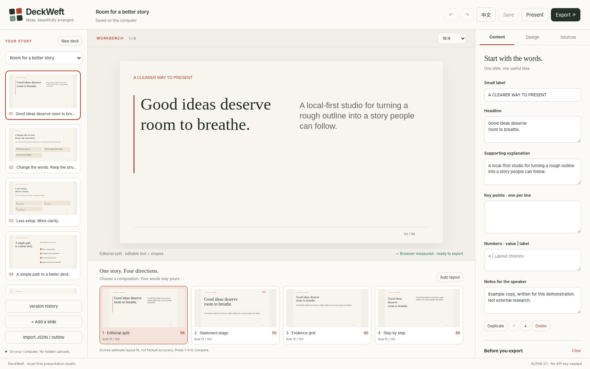

# DeckWeft

**把想法，排成清晰的故事。**

[English](README.md) · [从这里开始](docs/zh-CN/start.md) · [简单手册](docs/zh-CN/manual.md) · [路线图](docs/zh-CN/roadmap.md) · [实际支持范围](docs/zh-CN/compatibility.md)



## 一句话说清楚：这是什么？

你手里有笔记，想要一套幻灯片。DeckWeft 就站在两者中间。

把它想象成一台织布机：你的文字是纱线，DeckWeft 把它们织成一块整齐的布——一套还能继续修改、保存、上台演讲，也能带去 PowerPoint 或网页里的演示文稿。

一切都在**你自己的电脑上**运行：不用注册账号，不上传云端，没有偷偷调用的 AI，也没有遥测。

**当前版本：`0.1.0-alpha.2`。** “alpha”的意思是：已经能用，但还很年轻，不是完整的商业演示软件替代品。

## 三步跑起来

1. 安装 **Node.js 22 或更新版本**。
2. 下载本仓库（绿色 **Code → Download ZIP** 按钮），解压后，在 `DeckWeft` 文件夹（里面有 `package.json` 的那个）中打开终端。
3. 运行：

```bash
node bin/deckweft.mjs studio --open
```

浏览器会打开工作台。**不需要再下载任何依赖。** 如果浏览器没有自动弹出，就手动打开终端里打印的本地地址。关闭前记得点“保存”；在终端按 `Ctrl+C` 即可停止。

## 像给小朋友讲一样：它怎么工作？

1. **你来写。** 粘贴纯文本或 Markdown，每页之间用 `---` 隔开。
2. **DeckWeft 出排版。** 每一页它都会试几种摆法、量一量尺寸，把最好的几种并排给你看，由你来挑。
3. **你来打磨。** 改文字、数字、图表、图片、颜色和顺序，都能撤销。不想被动的部分可以单独锁住。
4. **你带走成果。** 导出可编辑的 PowerPoint、单文件网页、PDF、单页 SVG 图片，或完整项目文件。

它始终守住两个承诺：

- **绝不偷偷删你的字。** 放不下就停下来告诉你，而不是把字缩到看不清。
- **排版分数不是事实分数。** “看起来很平衡”不代表内容是对的。

## 玩具箱（可以直接试的东西）

每条命令都会打开一个现成的演示；右边链接到使用说明和验证记录。

| 运行 | 可以玩到… | 了解更多 |
| --- | --- | --- |
| `npm run studio:visual-demo` | Visual Studio：三套主题（Cream Collage、Dark Data、Electric Violet）、中英文样例、图片裁切、历史恢复 | [Visual Studio](docs/zh-CN/visual-studio.md) |
| `npm run studio:compositions` | 六类页面构图、每页三种实测候选、整套文稿的节奏选择 | [说明](docs/zh-CN/visual-studio.md) · [证据](docs/evidence/vis-006/review.md) |
| `npm run studio:assets` | 保留原图的图片槽、本地 JPEG／WebP 转换、保护重点区域的裁切 | [素材](docs/zh-CN/assets.md) · [证据](docs/evidence/vis-007/review.md) |
| `npm run studio:components` | 数字精确、可编辑的图表，带箭头的图解，代码块，不会乱跑的注释 | [组件](docs/zh-CN/components.md) · [证据](docs/evidence/vis-008/review.md) |
| `npm run studio:interactions` | 图表筛选、图片前后对比、热点、分步讲解；键盘、触控和“减少动态效果”都支持 | [交互](docs/zh-CN/interactions.md) · [证据](docs/evidence/vis-009/review.md) |
| 先 `npm run visual:verify`，再 `npm run visual:review` | 一位“机器人校对员”：拍真实浏览器截图、找出排版问题、尝试小幅修复，再交给你审阅 | [视觉质量](docs/zh-CN/visual-quality.md) · [证据](docs/evidence/vis-010/review.md) |
| `npm run deck:create -- --brief examples/task-brief.zh-CN.json --out dist/my-task` | 完整的“规划 → 生成 → 检查 → 修复 → 导出”流程，每一步都存档，不怕丢 | [任务流程](docs/zh-CN/task-loop.md) · [证据](docs/evidence/vis-011/review.md) |

## 大功能，用大白话说

- **六个问题，三个方向。** 新建文稿时，DeckWeft 只问六个简单问题，然后把*同一份*内容做成三种不同风格给你挑，再开始生成。
- **作者控制。** 每次修改都会先说清楚要做什么，再动手；撤销就能退回去。文字、数据、来源、构图可以分别锁定。[作者控制](docs/zh-CN/visual-studio.md#作者控制章节与分项锁定s9a) · [证据（英文）](docs/evidence/s9a-author-controls/review.md)
- **讲解 → 图解 → 探索。** 一页先提出问题，再展示整体，然后让观众逐个点开每个部分对照整体看。静态导出也会保留完整说明。[怎么用](docs/zh-CN/interactions.md#讲解--图解--探索蓝图-as9b) · [证据（英文）](docs/evidence/s9b-blueprint-a/review.md)
- **提示词工作台。** 写下你想要的，看着它生成，单独改一页，查看真实截图，然后导出。语言、风格和锁定都会被记住。[工作台](docs/zh-CN/workbench.md) · [证据](docs/evidence/vis-013/review.md)
- **先排故事，再做页面。** 先审阅故事提案；批准后另存为新副本，旧版本原样保留。[规划](docs/zh-CN/planning.md) · [证据](docs/evidence/mb-06-10/review.md)
- **讲者模式。** 私密的讲者窗口（带备注和逐页提词器），加上独立的观众窗口。导出时默认不带私密备注，需要时再显式打开。[演讲](docs/zh-CN/presenting.md)
- **帮手与素材。** 可选的图片请求、两个互不干扰的 worker、带平面备份的简单 3D 场景，以及给 Figma 和 After Effects 的交接文件。[素材与 worker](docs/zh-CN/media-workers.md) · [证据](docs/evidence/mb-11-15/review.md)
- **演示样例。** [五分钟 DevDay 演示](docs/zh-CN/devday-demo.md)、带可编辑 PowerPoint 备份的离线[舞台示例](docs/examples/dot-stage/README.md)；在工作台地址后加 `?mode=pitch` 可进入纯英文演示视图。

## 让编程助手来用它

DeckWeft 可以作为技能装进 **Codex**、**Claude Code** 或两者。助手负责写大纲，DeckWeft 负责排版。

```bash
node bin/deckweft.mjs install --target both --scope project --dry-run
node bin/deckweft.mjs install --target both --scope project
```

第一条只是*预览*会发生什么，第二条才真正复制文件。把 `--scope project` 换成 `--scope user`，就会装到你所有项目都能用的位置。之后在 Codex 里输入 `$deckweft`，在 Claude Code 里输入 `/deckweft`。

如果要原生插件包，先运行 `npm run build`，再看[安装手册](docs/zh-CN/installation.md)。“复制成功”“宿主里启用成功”“在宿主里真正跑通”是三件不同的事。[宿主手册](docs/zh-CN/hosts.md) · [连接说明](docs/zh-CN/agent-bridge.md)

## 不打开工作台也能导出

```bash
node bin/deckweft.mjs check examples/welcome.zh-CN.deck.json
node bin/deckweft.mjs export examples/welcome.zh-CN.deck.json --format pptx --out welcome-zh.pptx
node bin/deckweft.mjs export examples/welcome.zh-CN.deck.json --format html --out welcome-zh.html
```

默认不会覆盖已有文件，确实要替换时才加 `--force`。英文样例是 `examples/welcome.deck.json`。

## 暂时还做不到的事

老实列出来，免得你踩坑：

- 不会自动上网查资料，没有内置的无人值守图片生成，也不能渲染视频。
- 不能导入任意 PowerPoint 文件，没有多人实时协作，没有在线账号或付费系统。
- 不能直接控制桌面版 Figma 或 After Effects，两个导入器都还是实验性的。
- 原生可编辑图表只存在于实验性的 v3 PowerPoint 导出（`npm run export:targets`）中，目前只检查过文件结构，还没在 PowerPoint 或 Keynote 里实际打开验证。[兼容性](docs/zh-CN/compatibility.md#v3-视觉演示文稿的-powerpoint-与-pdfs7vis-016)
- 部分真实宿主检查（Claude 登录、Codex 桌面版、Dot 桌面版）还没跑。[宿主验收](docs/zh-CN/host-acceptance.md)
- 切换界面语言不会自动翻译你的幻灯片。

## 拿证据说话，不靠徽章

上面每一条说法都有记录可查。先看[验证报告](docs/zh-CN/verification.md)、[机器可读状态](PROJECT_STATUS.json)和[本地测试输出](docs/test-results.txt)。已通过的本地检查，和尚未运行的宿主／软件检查，是分开记录的。

## 给开发者

```bash
npm ci
npm run verify
```

`npm ci` 安装 TypeScript 编译器，只在开发时需要，平时运行工作台用不到。`npm run verify` 会依次跑类型检查、测试、文档与源码检查、插件打包和示例导出。更多见[架构](docs/zh-CN/architecture.md)、[贡献说明](CONTRIBUTING.md)和[下一阶段交接](docs/zh-CN/handoff.md)。

代码和文档以英文为准；简体中文单独维护一套页面，不把两种语言挤在同一页里。

## 许可

MIT 许可证，Copyright (c) 2026 Feida Wang。详见 [LICENSE](LICENSE)；随附的第三方组件（图标、Three.js）和商标说明见 [NOTICE](NOTICE.md)。DeckWeft 与仓库中提到的任何厂商均无关联。`package.json` 中的 `private` 只是为了防止误发布到 npm，不影响在 GitHub 公开源码。
