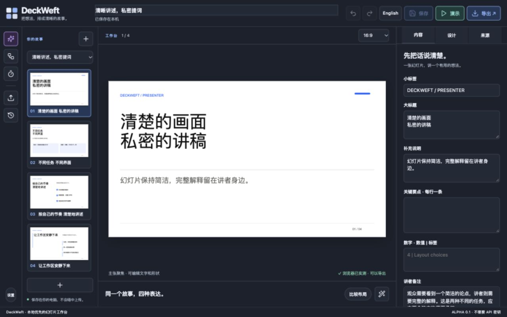
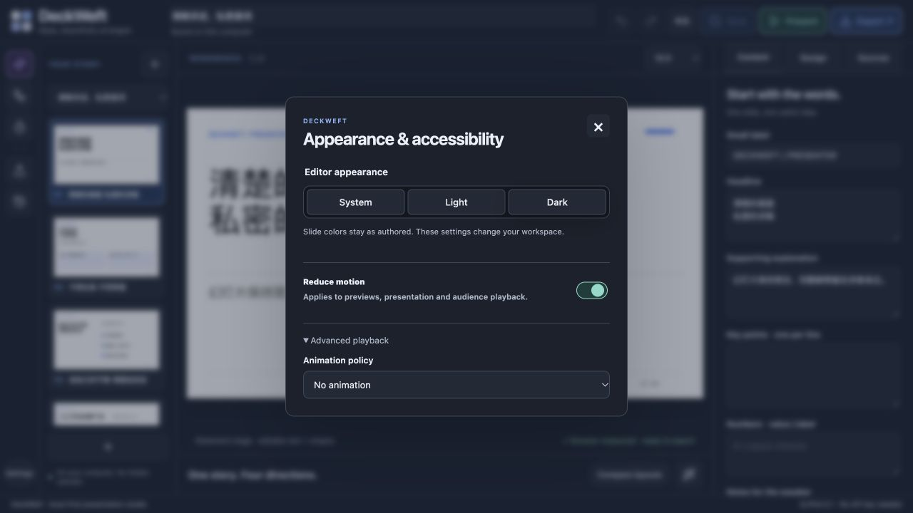
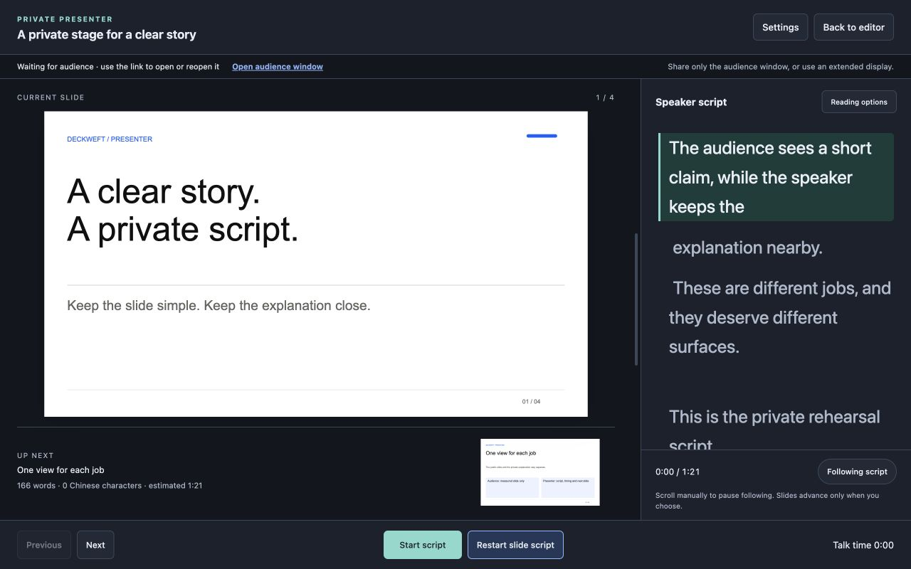
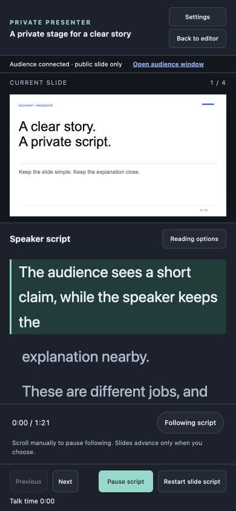

# MB-01–05 local implementation review — 2026-10-17

[English instructions](../../en/presenting.md) · [简体中文操作指南](../../zh-CN/presenting.md) · [Machine-readable evidence](review.json) · [Final verification log](verify.txt)

Scope: the adopted first five modules' local functionality. Type/build checks, HTTP boundaries, package isolation, speech timing and actual provided-browser flows were exercised. This is not a real conferencing/extended-monitor, screen-reader, other-engine or host-model certification. The temporary preview library contains authored product examples, not the user's working decks. No installed browser bundle or personal profile was modified.

## 1. Semantic actions and dark workbench

Generation uses purple, document actions blue, presentation teal and destructive controls red; labels and shapes supplement color. Primary actions show labels at desktop widths and retain accessible names at narrow widths. Collapsing the layout tray at 1280 × 800 increased the stage height from 415 to 567 CSS pixels and the slide width from approximately 674 to 700 pixels in the inspected state. This is one measured example, not a universal space-saving claim. Light/dark switches leave the authored slide palette unchanged.

## 2. Central settings and actual animation shutdown

Light/dark/system and reduced/off preferences work through the shared policy. A second editor tab changed motion to Off while the first was rendering Three.js. The first tab received the storage event; its DOM renderer counter stopped at 3039 and remained unchanged on a later observation, with `data-reduced=true`. Returning from presenter settings restored focus to its visible trigger. OS precedence is covered by unit tests; an actual OS appearance/reduction change was not performed.

## 3. Private Chinese presenter and live timing

The Chinese script initially estimated 1:17 at 240 characters/minute. At 300 it changed to 1:04, retaining the text anchor. Auto-follow remained true over an observed 46 seconds and advanced to scrollTop 733. A layout-scroll false-positive found during inspection was fixed by pausing only on user input intent. Manual Page Up paused following and Resume following restored it. Width changed from 380 to 600 and the dock changed to the left while retaining the highlighted phrase. The divider supports keyboard input too. Final QA corrected a fractional-time display boundary (63.99999999999999 now displays 1:04). No voice recognition is involved.

## 4. Public audience, independent origin and recovery

The audience showed the current slide only, with no inputs, private script or editor controls. Real browser polling synchronized slide 2 and the reduced motion policy. Refresh reconnected after the fragment had been removed from the address bar, using the tab-local capability. Closing the presenter cleared an already open audience view and displayed the ended message. The provided browser did not always honor the requested popup feature; the visible audience link successfully opened a separate tab. A real projector and conferencing share remain untested.

HTTP tests additionally check forged Host/origin rejection, missing/wrong capabilities, read-only methods, absence of editor bootstrap/project APIs, exact measured input binding, expiry/capacity limits, revocation and out-of-order control updates. Visual-export tests search all PPTX entries and HTML/handoffs for private sentinels, and verify explicit presenter variants retain supported notes. Project JSON remains intentionally complete.

## 5. English and narrow-screen reading

The English sample estimated 1:21. Pause held at 0:14 across subsequent layout checks. In reduced mode, the clock advanced from 0:14 to 0:25 while script scrollTop stayed 0. At 390 × 844 the script viewport was approximately 247 pixels high; at 320 × 740 it remained approximately 117 pixels high. Both retained the bottom controls and had no horizontal page overflow. A 768 × 900 layout retained the 380-pixel sidebar. The 1280 × 800 desktop state was also inspected. These are responsive checks, not a 200% browser-zoom test.

## Type/build and application boundaries

The schema remains version 1 with no migration or project-field rewrite. Seven negative type fixtures cover unsupported preferences, incomplete job/session states, public notes access, invalid motion presets, unchecked Project input and unknown action roles. Emitted core/browser pilot modules execute in the type gate. The copied plugin runs with no compiler, node_modules or devDependencies, and build-byte stability remains tested. The source launcher still runs directly with Node 22+.

Final command results and source/screenshot hashes are in review.json and verify.txt. PowerPoint, Keynote and Figma were not opened for this UI-focused batch. After Effects was not found in the checked application locations. Actual screen sharing, extended display, 200% zoom, screen reader, real OS IME and other browser engines remain acceptance work. DW-020 and the deferred Claude sign-in remain unchanged. No AI provider or Dot/Astra delegation ran.
