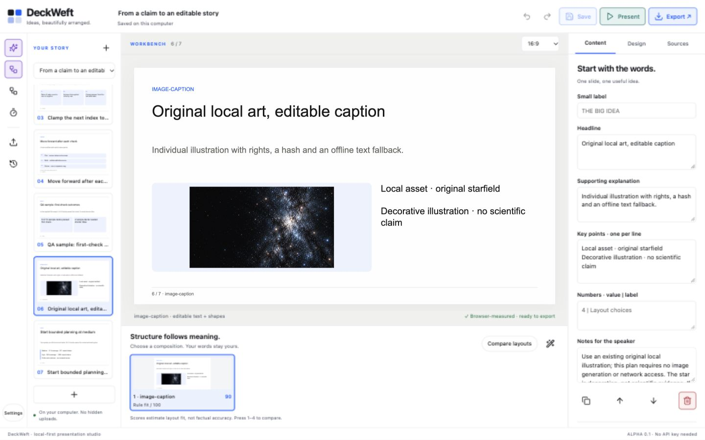
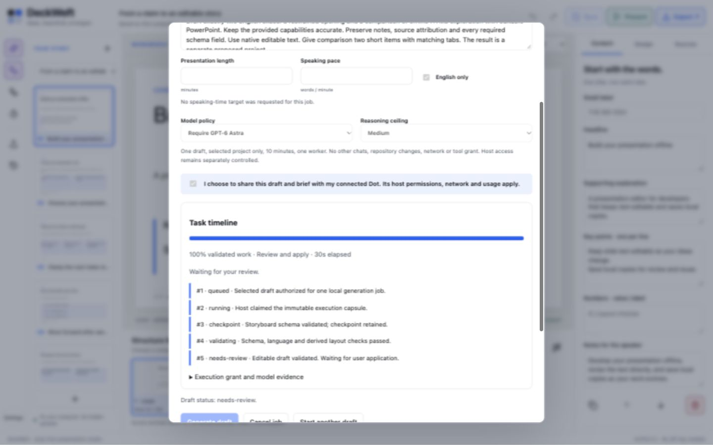
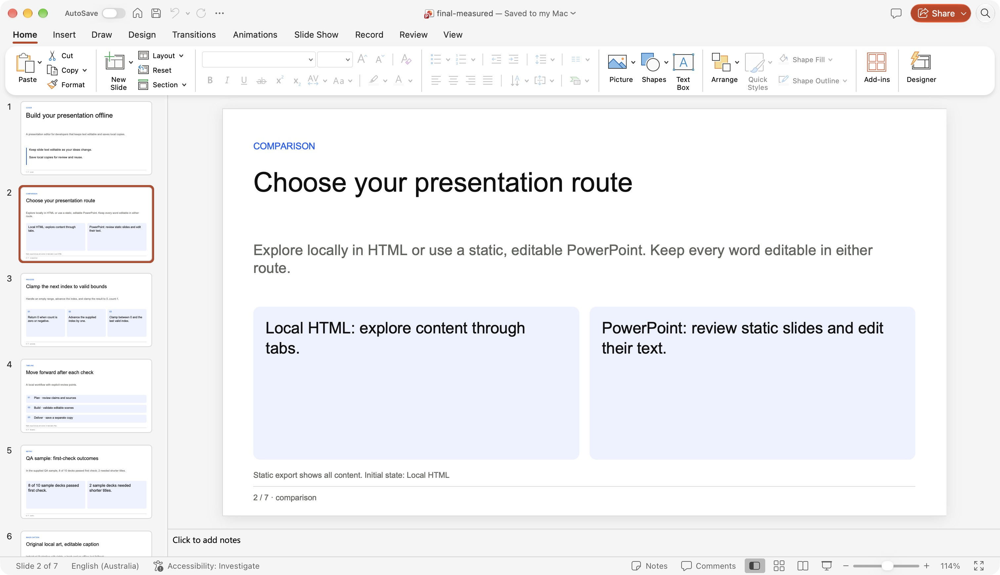
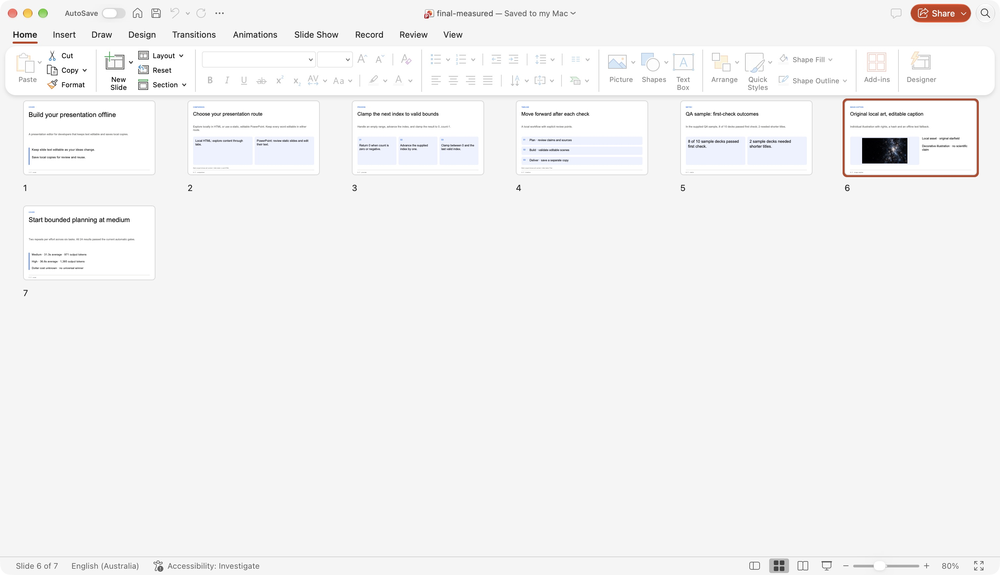

# MB-06–10 local review — 2026-10-17

[Guide](../../en/planning.md) · [Effort comparison](../../en/astra-evaluation.md) · [Machine-readable review](review.json)

`npm run verify` passed 207 tests, schema-derived type/negative-fixture and emitted-runtime checks, source checks, the reproducible plugin build and language/presenter demos. [Final log](verify.txt) · [Four reproducible planning artifacts](reproducibility.json).

The user authorized MB-06 through MB-10. Narrative and visual planning, semantic templates, scoped single-host jobs, checkpoints/progress and a bounded actual Astra effort pilot are implemented locally. **MB-08 remains partial:** no Dot browser surface/host was available. A real Codex CLI task is recorded separately and does not close Dot desktop or the older DW-020 host gate.

The repository had no Git metadata. Work took place in `/Users/feida/Developer/DeckWeft`; test projects and exports use `dist/mb-06-10/demo/library`. The normal user library was not used. Installed browser bundles and personal profiles were not modified. There are no new runtime dependencies, providers, telemetry, remote uploads, releases or publishing actions.

| Boundary | Observed result |
| --- | --- |
| UI → planning API → project | A two-slide proposal was edited and saved as a separate v2 project; source retained |
| v1 → v2 | Explicit copy migration; validator rejects invalid current input, missing references and unsupported interaction families |
| Asset → scene → export | Content-addressed PNG with rights/alt/fallback, hash/type/path/budget checks; image stays an independent object |
| Host → grant → capsule | Actual CLI task claimed an immutable capsule and returned a schema-valid two-slide proposal; no ungranted tools observed |
| Checkpoint → restart → events | Automated real-filesystem and subprocess tests; monotonic cursor log, exact retries, expiry, cancellation and renewed grants |
| Review → apply | Actual browser save-as-copy; queued application/cancellation use one lock and result identity is idempotent |
| Progress | Validated task weights, real artifact units, opaque turns indeterminate; disconnected/review states have no confident ETA |
| Browser → exports | Measured HTML/PPTX downloaded from the actual UI; public exports omit private notes |
| PowerPoint | Final seven-slide PPTX opened without repair; native text and independent image inspected |

The paired pilot consists of four actual CLI turns, six tasks each. Both efforts passed 12/12 task results with zero repairs. Mean batch times were 31.271 s (medium) and 36.567 s (high); mean output tokens were 971 and 1,385. Dollar cost and independent server model confirmation are unavailable. This is a limited planning pilot, not a universal effort ranking or a blinded human review.

The provided browser directly loaded the loopback Studio and exported HTML with production CSP. Seven English scenes and one Chinese/mixed scene completed actual browser measurement. Three confirmed widths (390, 1024, 1440) had no document-wide horizontal overflow. The 390px storyboard, mouse/arrow-key exploration and source-copy recovery were exercised. Console checks on active Studio and player pages found no errors. A development-server restart invalidated an older tab's session token; the documented reload recovery succeeded.

Actual application review found a PowerPoint default corner-radius mismatch. Source now writes the scene radius as a DrawingML adjustment; the final comparison screenshot confirms the fix. Package inspection confirms seven slides, 49 native text shapes, one picture, valid CRC/XML/internal relationships and omitted private notes. [Final package inspection](pptx-inspection.json).

Figma and Keynote were installed but not run for this batch. After Effects was absent from `/Applications`. Dot was absent from the provided browser inventory. Screen reader, 200% browser zoom, other engines, conferencing and extended-display gates remain separate. Experimental Figma/AE media import remains blocked explicitly; no whole-slide raster fallback is used.
