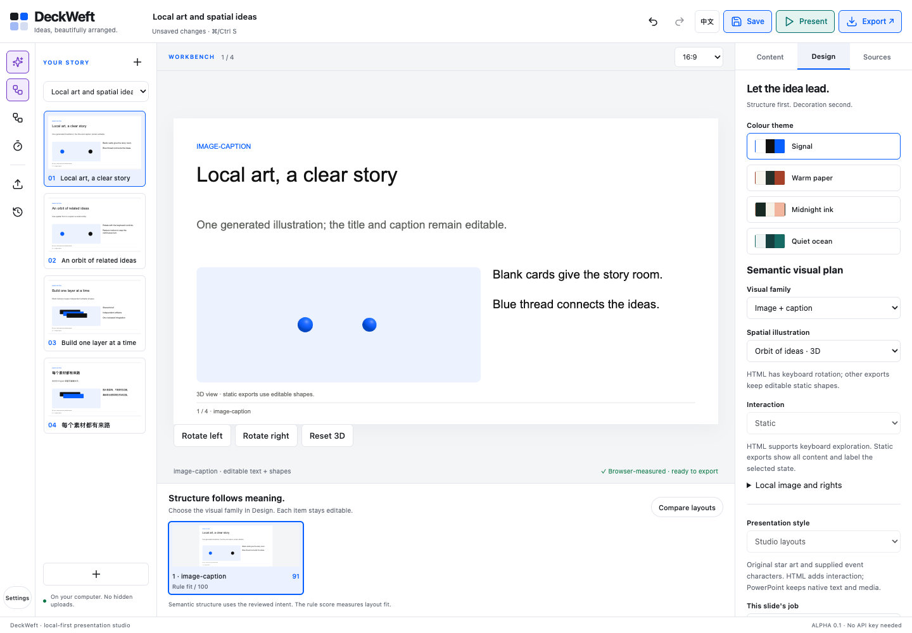
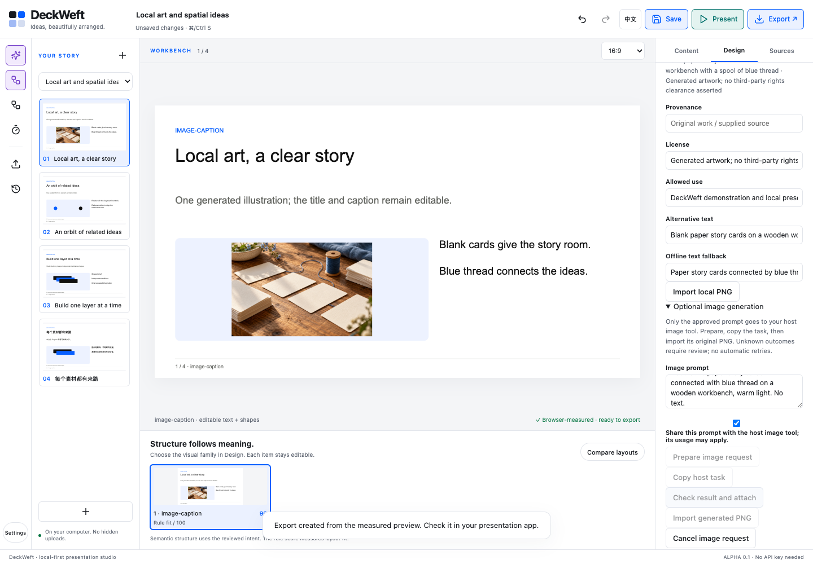

# MB-11–15 local implementation review — 2026-10-18

[Guide](../../en/media-workers.md) · [中文指南](../../zh-CN/media-workers.md) · [Machine evidence](review.json) · [Verification log](verify.txt)

This workspace has no Git metadata or branch. The user authorized MB-11–15. Source, runtime and tests remain separate from generated `dist` outputs. No installed browser app bundle or personal browser profile was changed, no runtime dependency was added, and no repository/package/release was published.

| Task | Observed scope | Acceptance state |
| --- | --- | --- |
| MB-11 | Opted-in host-tool prompt journal, single dispatch, duplicate pending-request prevention, cancellation, original-PNG registration, rights/alt/fallback records, local cache and stale-draft attachment checks | implemented-local; one actual tool artwork, followed by local journal integration |
| MB-12 | Two identity-bound workers, explicit selected snapshots, independent owned leases, one transaction writer, isolated exact-path code copies, overlap rejection and stale-source checks; actual concurrent CLI pair | partial; actual Dot desktop remains open |
| MB-13 | Orbit/layer recipes, shared native scene text/shapes, lazy local renderer, bounded resources, reduced/off/manual controls, actual context-loss fallback and print fallback | implemented-local |
| MB-14 | Embedded PNG fills, explicit missing-font decision, fixed layouts, node/font report, cancellation and layer/frame rollback | partial; real assigned-plugin Figma import has not run |
| MB-15 | Native text/shapes, separate PNG footage, explicit temporal seconds/ease/rise map, strict JSON, ES3 report serializer, folder cancellation and tracked item/file rollback | partial; real AE import and rendered frames have not run |

## Actual local observations

The [browser report](browser.json) records direct loopback checks in an isolated cached Chrome for Testing 151.0.7922.34 with ephemeral profiles. The provided in-app browser also opened the actual HTML and its orbit view. Four English/Chinese-mixed slides and both actual CLI worker results were opened for visual review. Checked screenshots include generated art, WebGL orbit/layers, loss fallback, Studio and Chinese text. There were no observed uncaught page errors, and the document did not overflow horizontally at 390, 1024 and 1440 CSS pixels.

Reduced motion stopped the active render loop; Enter on a rotation button still produced a manual frame. Actual `WEBGL_lose_context` restored shared native SVG shapes. Printing exposed static shapes and hid the canvas and controls. The standalone HTML made no remote requests. Studio exercised recipe selection, local save/reload, prompt consent, one journal dispatch, original generated-PNG completion/attachment and all four measured visual/handoff exports. Source fixtures and the optional reproducible harness are under `scripts/media-demo.mjs` and `tests/browser_media.mjs`; build artifacts stay in `dist/mb-11-15`.

The [PPTX inspection](pptx-inspection.json) independently parsed ZIP CRCs, every XML/relationship, all original titles/body/items and private-notes omission. The four measured slides contain 23 native text shapes and one picture; the embedded PNG hash matches the project asset. This is package evidence, not an Office render. PowerPoint and Keynote were not opened for this batch.

The [original artwork](workbench-generated.png) came from one actual built-in image-tool call. [Exact prompt and limits](image-prompt.txt). It was visually inspected for the requested blank cards, blue thread, decorative use and absence of text/logos. The live call happened before journal integration; subsequent tests supplied that original output and do not claim the journal controlled the earlier host call. No API key or provider SDK was used. Monetary tool cost was not supplied. [Measured renderer costs](render-cost.json).

The [initial worker attempt](worker-first-run.json) failed strict validation on a returned source URL and did not apply an invalid result. The initial runner failed before preserving raw responses or usage; those values are unavailable. A separate [second CLI pair](worker-review.json) explicitly required empty source/evidence arrays for the no-source authored inputs. Both results passed without output coercion and were serially integrated as separate new projects; the source projects were untouched. Their measured overlap was 12.547 seconds, latencies 12.550/16.264 seconds, reported output tokens 577/682, ungranted tool events zero. CLI model/effort flags were Astra/medium; API model attestation and dollar cost remain unknown. Selected snapshots were authored test text; no existing chat was read and no new desktop chat was created. [Alpha result](worker-alpha.deck.json) · [Beta result](worker-beta.deck.json).

## Application limits

Figma desktop was launched, its existing DeckWeft file opened, and the native Plugins menu inspected. The menu remained at “Loading…” and the app screenshot API became unavailable. No development-plugin id was obtained, no manifest id was invented, and no actual importer run/layer/font/media review passed. The Figma MCP cloud-authoring path was not used as a substitute for native-plugin acceptance.

After Effects was absent from `/Applications`. No installation, license or permission setting was changed. Actual native import, cancel/rollback, font resolution, easing and early/middle/settled preview render remain required. Local VM tests are explicitly mocks. Dot desktop and the older Claude/native-host, remote CI, screen-reader/zoom and conferencing/extended-display gates remain unchanged.

## Visual evidence

[All HTML scenes and orbit](html-orbit.png) · [Context-loss fallback](html-context-loss.png) · [Layers](html-layers.png) · [Chinese/mixed](html-chinese.png) · [CLI alpha](worker-alpha.png) · [CLI beta](worker-beta.png)
