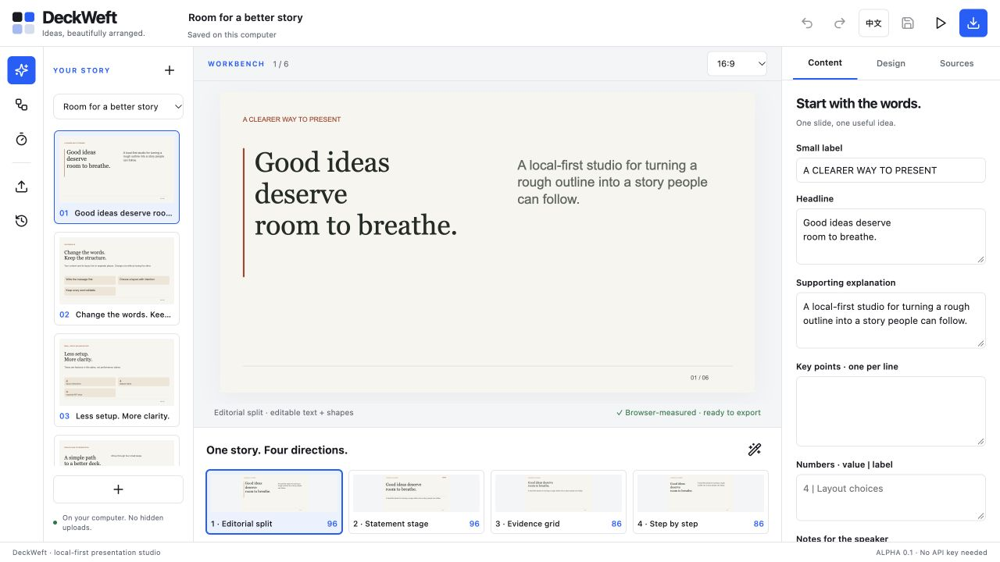
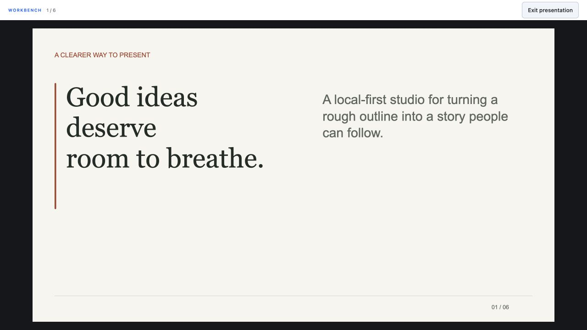
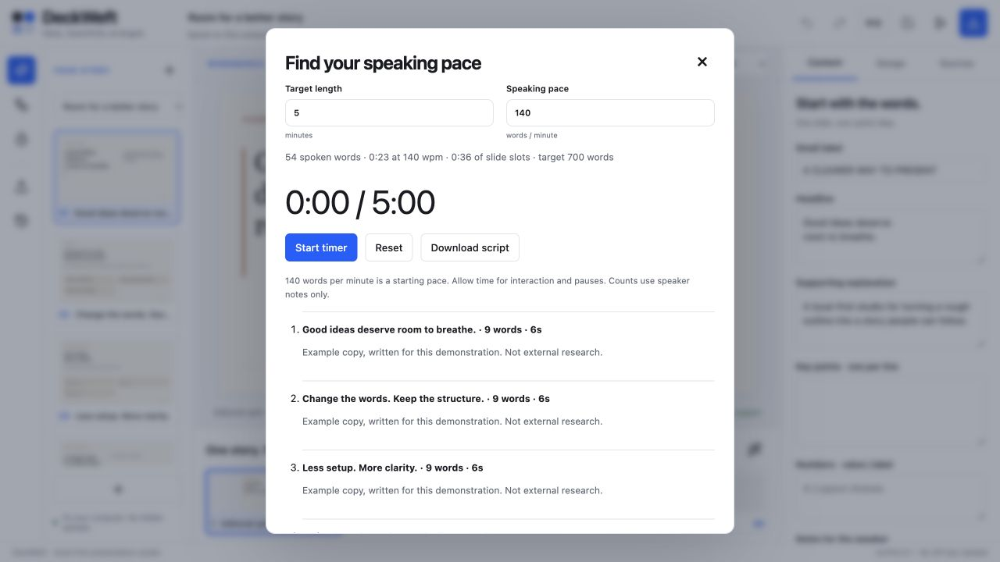
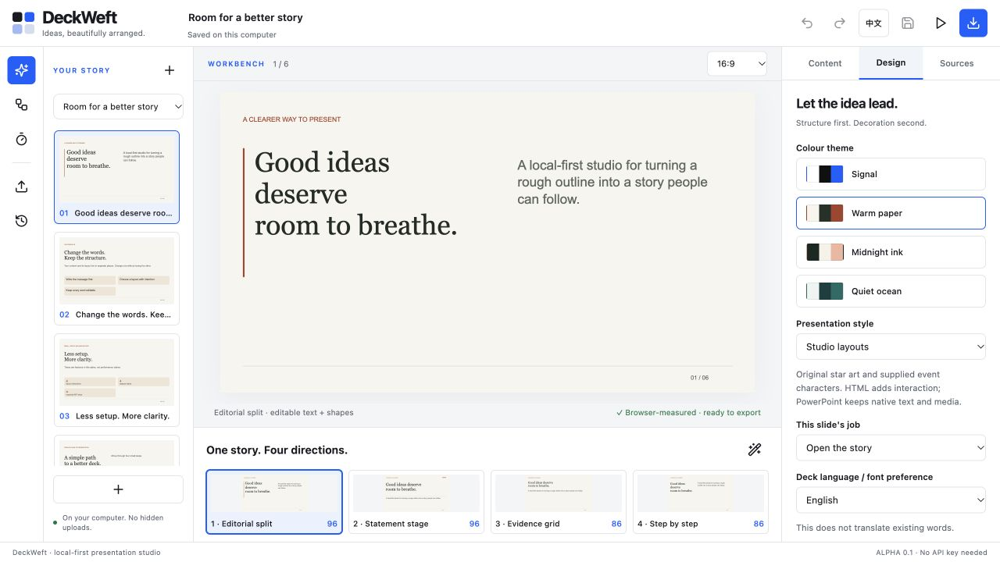
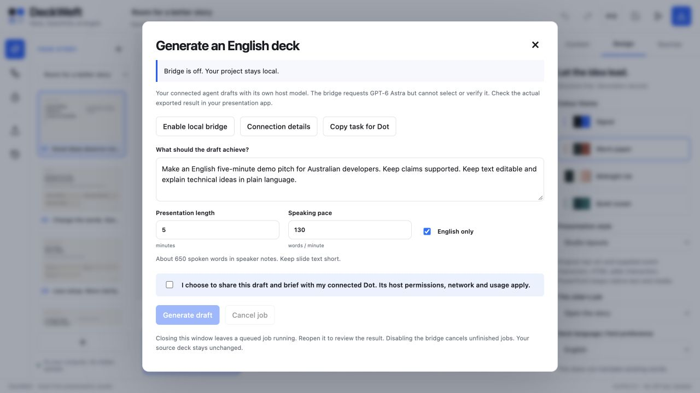

# Roadmap inspection — 2026-10-17

Scope: inspect the current workbench, Studio presentation, rehearsal dialog, Design panel and disabled agent-generation dialog to ground the requested construction roadmap. No implementation, model invocation, image generation, chat delegation or host integration was attempted.

The application ran with Node v24.14.0 on loopback in a temporary library, using the provided in-app browser at a 1280 × 720 viewport. Each screenshot was captured in this run, saved, reopened from disk and visually inspected. Installed browser bundles and personal profiles were not changed.

## 1. Workbench — usable, action roles can be clearer

The outline, canvas and inspector are clearly separated, and accessible control names are exposed. Generation and export both use strong blue, while many other tools use similar small icon controls. The four-layout tray occupies persistent vertical space. Speaker notes begin below the visible inspector area at this viewport. Recommended work: a small semantic action vocabulary, discoverable labels and a collapsible layout tray. This is a usability observation, not a measured task-time or contrast failure.

## 2. Studio presentation — slide is visible, private pitch is absent

Presenting shows the slide and an exit control in the original editor document. There is no visible presenter script, resizing control or second audience window. Source inspection confirms the view is switched with a body class. Recommended work: distinct audience projection and presenter surface. No real second display, conferencing share or privacy guarantee was tested.

## 3. Rehearsal — useful count and timer, interrupted workflow

The dialog exposes pace, target duration, word count, timer and all speaker notes. It covers the workbench and does not provide a slide-following teleprompter. Recommended work: reuse these calculations in a persistent presenter sidebar, with pause/resume and separate spoken/animation timing. Source review found English-oriented counting; Chinese pace acceptance still needs implementation and tests.

## 4. Design — settings exist, viewer preferences are missing

Themes and presentation style are visible. The accessibility tree exposes per-slide entrance/duration controls farther down the inspector. The visible dark palette is a slide theme, not an editor night-mode control. Recommended work: separate document style from viewer appearance/motion preferences and centralize the latter. This inspection did not change a theme, test OS preference changes or certify accessibility.

## 5. Agent dialog — honest consent, no orchestration surface yet

The bridge is off; generation is disabled and the copy states that Astra cannot be selected or verified by the bridge. Consent is explicit. No worker progress, task timeline or effort control is present. Recommended work: real host capability negotiation, selected-scope authorization, job events and measurable progress. The bridge was not enabled, and no agent or account was contacted.

## Verification and limits

The baseline `npm run verify` passed 176 tests, source checks, plugin build and both-language demo generation. The final roadmap verification is recorded separately in [verify.txt](verify.txt) and [review.json](review.json). This is stronger current test-count evidence than an older report's 165-test snapshot, but it is not a new host acceptance run.

Five visual states were inspected. Keyboard/IME, screen reader, 200% zoom, other browser engines, actual projection and conference sharing were not tested in this roadmap inspection. PowerPoint, Keynote and Figma installations were detected but not opened or verified. After Effects was not found in the checked application locations and was not run. Actual Dot/Astra selection, image generation and Figma/AE importer acceptance remain unverified.

The prioritized recommendations and engineering acceptance gates are in the [English plan](../../en/modular-build-roadmap.md) and [Simplified Chinese plan](../../zh-CN/modular-build-roadmap.md).
