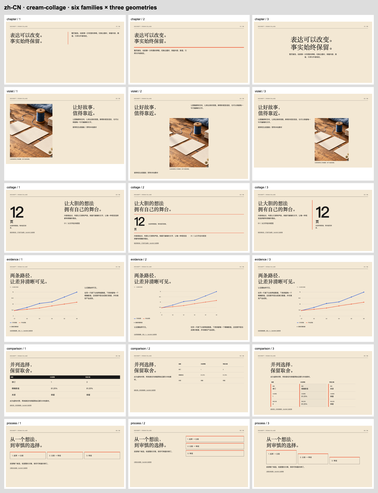
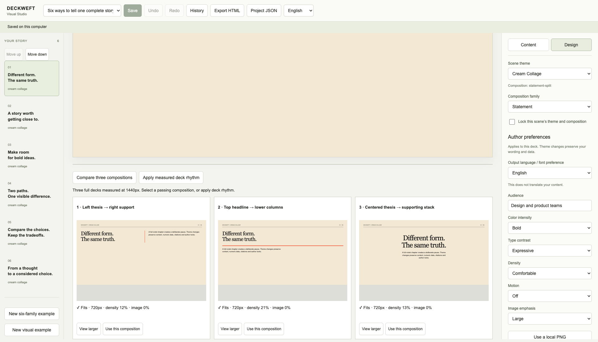
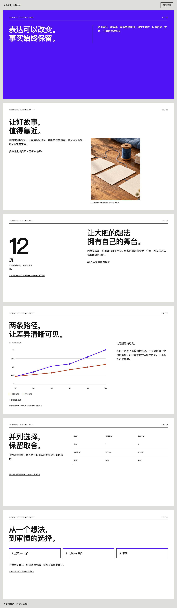

# VIS-006 — measured compositions and whole-deck rhythm

2026-10-18 · local source implementation. [Machine review](review.json) · [Browser receipts](browser.json) · [Legacy browser regression](legacy-browser.json) · [Final verification](verify.txt) · [Source fingerprint](source-manifest.json) · [Manual](../../en/visual-studio.md).

## Result and scope

Six initial families provide eighteen renderer geometries. Visual Studio compares real candidates, opens a larger inspection view, applies one page or a measured whole-deck selection, and reorders pages by stable identity. Chosen compositions persist through save/reload, undo and history. The semantic document, exact numbers/datasets, source snapshots/anchors, local assets, crops, focal bindings, author locks, theme identity and color modes remain intact. V1/v2 paths are retained; native v3 export and real-host generation remain outside this batch.

No runtime dependency, service, image request, font binary, upload or telemetry was added. LICENSE and NOTICE.md remain intact. No installed browser or personal profile was changed; no publication or push occurred.

## Structural differences actually reviewed

| Family | Candidate 1 | Candidate 2 | Candidate 3 |
| --- | --- | --- | --- |
| Statement | Left thesis / right support | Top headline / lower columns | Centered headline / supporting stack |
| Image narrative | Image first on left | Text, then separate image and caption | Full headline, text left / image right |
| Oversized number | Number first on left | Full-width number band between heading and support | Thesis left / number right |
| Data evidence | Plot left / evidence right | Full-width plot with notes below | Evidence left / plot right |
| Comparison | Wide matrix | Question rail / matrix beside it | Dimension cards with labelled, stacked attributes |
| Process | Horizontal sequence | Thesis beside vertical sequence | Diagonally stepped sequence |

The derived scene's DOM reading order follows the intended route where geometry moves semantic regions; the source document and its block order are unchanged. Every original table heading/cell and diagram node/edge remains. Schemas and the three versioned theme packs enumerate the new geometries while retaining all older values. The code stays in `src/design`, derived web scenes and the semantic web renderer, leaving the legacy layout/export path independent.

## Browser evidence

An isolated cached Chromium **151.0.7922.34**, outside `/Applications`, used ephemeral contexts. `tests/browser_compositions.mjs` measured **18 complete candidate decks / 108 candidate scenes** (six families × three variants × three themes × two languages). Every representative family/theme/language has **three distinct actual DOM geometry signatures** and **at least two feasible choices**. Actual platform fonts were queried through Chromium; browser-reported font readiness, region bounds, text containment, contrast and clipping are recorded.

**96 / 108** candidates meet the 1440px-wide, maximum-900px-height presentation budget. Twelve deliberate refusals remain: sequential image and full-width evidence candidates exceed that budget with this complete portrait-crop / evidence content, in each theme/language. For example, English Cream Collage's image variant is approximately **980px**, and its evidence variant approximately **911px**. They retain every block and remain inspectable; they are disabled for selection. The other two variants pass. A separate dense-text case also retains all text and fails the height gate. No words were removed or fonts reduced to manufacture a pass.

Six selected six-page decks also pass the browser's DOM checks at **1440, 1024 and 390px**, with no document-wide horizontal overflow in those tested views. All **135 PNG captures** remain in `dist/visual-compositions/acceptance`; the six contact sheets, six whole-deck captures and three editor/inspection views are copied here. The primary editor API ran over direct loopback; the exhaustive standalone captures loaded exact exported HTML through scoped Playwright response routes on that origin. Live candidate artifact/measurement/selection routes were exercised independently in the editor, with the output CSP intact.

Direct UI checks cover three candidate previews, larger inspection, selected composition save/reopen, measured rhythm, stable-theme reorder, edits invalidating receipts, and rejection of unmeasured/stale candidate batches. The separate existing Visual Studio harness passed **22 check entries**, including real two-tab revision conflict, edits during an in-flight save, read-only history/restore-as-copy, local PNG replacement, explicit legacy migration preserving input, measured HTML download, no-JavaScript reading and inserted contrast/clipping failures. Both final reports record **zero page errors and zero external requests**.

## Rhythm behavior

The browser reports the focal region's position, occupied content area and image area relative to the scene. Density includes the actual bound region/graphic areas and is a rough visual-area heuristic; it is not word complexity or aesthetic quality. Dynamic programming chooses the minimum sum of adjacent transition costs among passing candidates: same geometry 8, same focus zone 3, density difference below 0.12 adds 2, same theme/color mode 2, and image-area difference below 0.15 adds 1. Ties are deterministic.

Theme/color mode, scene order and content remain fixed during selection. Their repetition costs describe unavoidable rhythm constraints; the selector does not recolor pages or move evidence to improve its score. Users can move pages explicitly and compare again. Locked compositions remain fixed. A blocked page stops whole-deck selection with its scene id. Browser receipts are bound to exact project hash, render hash, scene source hash and batch, expire after ten minutes and are invalid after edits/order/revision changes. The selected plan and a basis-hashed decision report persist in project JSON; earlier reports are historical evidence of their recorded basis.

Seven new Node tests cover all themes/languages, lossless candidate construction, required semantic content, changed reading paths, global optimality against exhaustive search, every transition term, failed-candidate exclusion, locks/order, stale saves/history recovery, exact metric decimals and geometry retention across theme changes. `npm run verify` passed **247 tests**, schema-derived types, source checks, reproducible packaging and demos. The capsule expectation now includes the explicitly authorized VIS-006 and continues to exclude VIS-007; no worker permission grants were expanded.

## Failures and repairs

- [Attempt 1](attempt-1.json): the test accidentally retained its preceding 390px reading viewport for the height stress assertion. The harness now explicitly selects 1440px. The presentation budget was not weakened.
- [Attempt 2](attempt-2.json): the harness seeded image bytes into the parent library while the live API correctly read the separate visual store. It now uses `store.home` consistently. [Actual missing-asset refusal](attempt-2-missing-asset.png) is retained.
- [Legacy click failure](legacy-overlap-failure.json): Chromium/CDP child-frame boxes omitted the ancestor iframe scale. The automated click landed on the later citation even though inspected DOM boxes did not overlap. The regression harness now transforms the observed child/frame geometry for a **real mouse click**; the exact data table opens. There is no forced/dispatched click and no installed-browser modification. [Failure screenshot](legacy-overlap-failure.png).
- Visual review found the early third comparison too similar to the matrix. It now uses dimension cards, stacked attributes and repeated column labels without discarding the original header or cells.
- Large-number rendering inherited `Intl.NumberFormat`'s default three-decimal rounding. It now uses a 21-significant-digit budget; `81.250125` is a regression case.
- Selection initially left the previous measured export enabled while its request was pending. It now clears the current render before applying a selection and waits for the new measured preview; a no-op also refreshes the preview.
- New composition rules initially enlarged citation paragraphs. The final rule retains their caption scale. Metric-band reading order now explicitly places the number before its explanation.

## Visual observations and remaining gates

Actual screenshot pixels for all six contact sheets and all six complete selected decks were inspected, together with the Chinese metric, live editor comparison, enlarged candidate and final rhythm report. Cream Collage retains serif typography and warm paper; Electric Violet retains its violet chapter/white-page contrast and sans-serif display; Dark Data retains its dark evidence palette. The silhouettes differ within each family. The selected six-page sequence alternates thesis, image, number, plot, comparison and process while preserving the page's assigned theme. Deliberate whitespace remains visible; visual-area scores are not claimed as human design certification.

PowerPoint, Keynote and Figma were found but not launched for this HTML batch. **After Effects was not found** in the checked application roots. [Read-only availability check](app-availability.json). Other engines, real OS IME, screen reader, 200% zoom and projection were not tested. VIS-001 remote CI, VIS-014's broader gallery/story gate, native v3 target compilers and host acceptance remain open. This six-page acceptance does not close those later gates.

