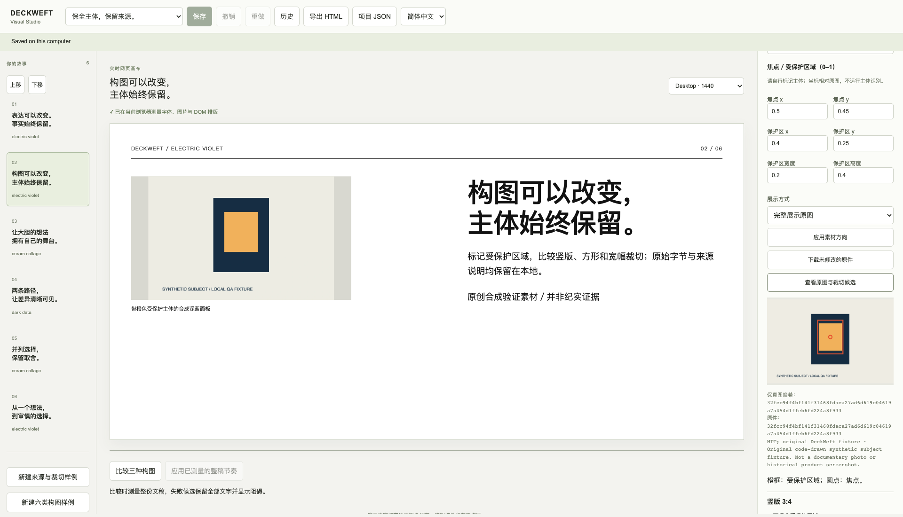
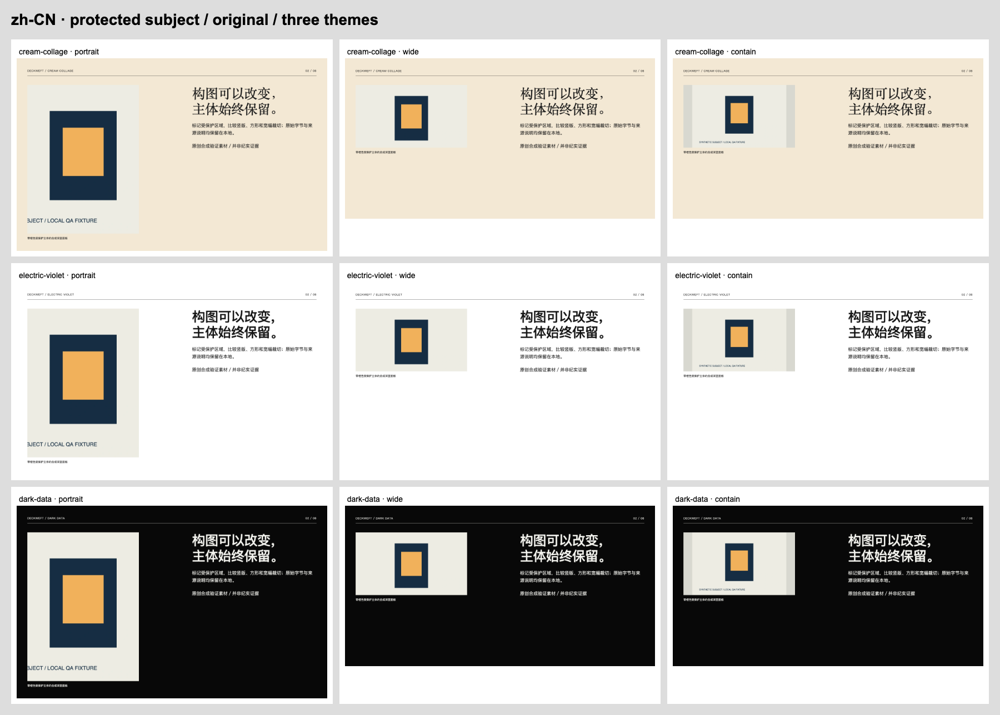

# VIS-007 — asset direction, source extraction and protected cropping

2026-10-18 · implemented locally. [Machine review](review.json) · [Browser receipts](browser.json) · [Legacy browser regression](legacy-browser.json) · [Composition regression](composition-browser.json) · [Verification log](verify.txt) · [Source manifest](source-manifest.json) · [Manual](../../en/assets.md).

## Implemented scope

Visual Studio now has typed, named image slots: role, minimum visible source pixels, focal point, protected rectangle, factual status, source reference, display mode and an honest backend capability. Local PNG/JPEG/static WebP originals are retained unchanged. JPEG/WebP inputs get a full-size, correctly oriented native PNG; an optional browser-encoded JPEG/WebP web derivative records its original source hash and lossy method. There is no new runtime dependency, remote service, API-key lookup or automatic image request.

Replacing a slot preserves its scene family, theme, current crop/direction, unrelated semantic content, datasets, citations and author choices. A shared semantic image gets a dedicated binding in the selected scene, leaving other scenes alone. Image content locks also protect their crop/slot decisions; scene crop/slot locks reject edits. Metadata conflicts stop replacement instead of silently replacing attribution. Files are content-addressed and immutable: repeated imports reuse identical bytes, and a corrupted addressed file is refused instead of overwritten.

Source extraction is explicit and local: choose a registered asset in a saved v2/v3 document. The source revision, project hash and asset id are recorded with the selection; native bytes, original/derivative chain, provenance, license and allowed use are copied without modifying the source document or files. This is not arbitrary PowerPoint/PDF extraction. Existing v1/v2 storage/export and explicit migration paths remain separate.

Protected crops use author-marked geometry, not automatic subject detection. Portrait, square and wide choices are feasible only when the protected rectangle and required pixel budget fit. Otherwise they fail, with complete-image **contain** offered as a deliberate action. Nothing deletes semantic content to improve a score. Unprotected parts of an illustration may be cropped; important screenshot labels must be included in the protected rectangle. Screenshot/factual slots always use native PNG. Generated/unclassified images cannot satisfy a factual slot, and no workflow silently upgrades their classification. Origin is still an author declaration, not independent proof of a claim.

V3 reports no connected image-generation transport. Reuse, source extraction and **Choose text-led alternative** are available; the alternative changes composition explicitly and preserves every existing block/lock. No provider is dispatched, no chargeable request is retried, and the old opt-in v2 host job's authority is not inherited.

## Verification and actual browser work

`npm run verify` passed **255 tests**, schema-derived types including the asset brief, source checks, reproducible packaging and bilingual/legacy demos. Eight new Node tests cover geometry and impossible crops; real container fixtures and EXIF orientation; immutable hashes and duplicate reuse; source-copy corruption/symlink refusal; shared bindings and metadata conflicts; quality/factual/lock failures; derivative/native selection and derived-region binding; stale revisions and recovery of both earlier and asset-bearing historical snapshots.

The optional `tests/browser_assets.mjs` ran a real direct-loopback Studio with isolated cached Chromium **151.0.7922.34**, outside `/Applications`, ephemeral contexts and no personal profile. It records **12 check entries**, **36 crop/viewport cases** and **53 PNG screenshots**, with **zero page errors and zero external requests**. Exhaustive standalone views load exact exported HTML through scoped response routes under its CSP; actual editor artifact and asset APIs use the live server.

Real UI flows exercised all three crop choices, whole-subject rejection and explicit contain, JPEG import with native PNG/WebP, WebP import with native PNG/JPEG, EXIF-6 JPEG rotation, exact original download, repeat import without a new manifest or source-file rewrite, factual screenshot PNG selection, generated-evidence refusal, lock-disabled controls/API refusal, source extraction from both saved v2 and v3 documents, and an unavailable-generation text-led alternative without content loss.

Native pixel probes independently decoded original and retained PNG bytes through the browser. JPEG, WebP and the rotated JPEG each had **maximum RGBA channel difference 0** in these three authored synthetic fixtures. EXIF-6 input retained its original 1200×800 bytes/metadata and produced an oriented 800×1200 native PNG. These observations establish the tested browser conversion path, not universal codec/color-profile certification. The server validates container/dimension/hash identity and does not claim to independently decode pixels.

Cream Collage, Electric Violet and Dark Data were checked with English and Chinese content in portrait, wide and complete-image modes, at **1440px and 390px**. All six complete six-page decks were captured. Existing Visual Studio's **22-entry** browser regression and the VIS-006 **108-scene** candidate/rhythm regression were rerun separately. They retain the evidence scope of editing/save/reopen, in-flight saves, real revision conflict, history/restore, v1/v2 migration, numeric data, candidate feasibility and theme identity after reorder.

The asset demo renderer ran twice with identical manifests/output hashes. [Render manifest](render-manifest.json). Its original authored subject fixture is **33,292 bytes** as native PNG and **10,458 bytes** as the selected WebP, about 69% smaller for this one simple synthetic image. Standalone bilingual six-page files are approximately 52 KB. This is a measured fixture result, not a general photographic compression benchmark. Originals/native PNG remain retained. No full slide is rasterized: only independent image assets use raster files.

## Visual inspection and repairs

Actual screenshot pixels were viewed for both nine-view crop contact sheets, all six full decks, original/protected-region guides, the portrait and impossible-crop cases, local source replacement, Chinese controls and mobile reading. The orange subject stays complete in portrait/wide crops, while contain shows the entire source and its synthetic-fixture label. Original/source hashes and license/provenance remain visible in the inspector. Three theme identities and bilingual type hierarchy remain readable.

Repairs recorded during implementation:

- Two initial Node assertions used the wrong PNG error code and a restore id shorter than the established 16-character minimum. The tests now follow the existing contracts; no production validation was weakened.
- An image-slot-only scene lock did not initially compare indirect crop changes. It now protects those dependent crop decisions as well, and a tampering assertion verifies refusal.
- A new pixel-probe harness attempted `fetch(data:)`, which the existing Studio CSP correctly blocked. [Failed probe receipt](pixel-probe-attempt.json). It now constructs blobs from in-memory bytes; CSP was not relaxed.
- The demo protected rectangle was slightly shorter than the complete orange subject. Visual review led to expanding its authored height from 0.35 to 0.40 and centering the focal point at y=0.45. This was a correction to the fixture's author marking, not hidden subject recognition.
- The library selector initially displayed a different title when opening a requested project. Activation now selects the actual project id.
- A mobile full-page capture initially showed an unpainted iframe outside the active viewport. [Earlier capture](mobile-before-paint.png). The harness now brings the preview into view and waits two animation frames before capturing; the inspected final screenshot shows the slide. This did not require an installed-browser or application policy change.
- Missing originals/derivatives/source files now produce explicit restore-the-matching-file errors. Conflicting hash/rights records and lossy transparency failures remain blockers.

## Boundaries and remaining gates

Uploads are bounded at 1.3 MB per source/encoded request; source/container inspection also has 8192px/side, 24-million-pixel and 4 MB per-file bounds. Original/derivative source reads have aggregate limits, and legacy scene-binding export budgets remain enforced. Full native dimensions are preserved; conversion does not shrink files automatically to meet upload limits. An unsuccessful multi-step import can leave an immutable uploaded blob for recovery, but no project binding is committed. Automatic pruning is not implemented.

PowerPoint, Keynote and Figma were found but were **not launched** for this HTML/asset batch; **After Effects was not found** in the checked application roots. [Read-only availability check](app-availability.json). Native v3 target compilers, actual host generation, subject detection, arbitrary external document parsing, other engines, real OS IME, screen reader, 200% zoom, projection, VIS-001 remote CI and VIS-014's broader release gate remain open.

LICENSE and NOTICE.md are unchanged. Installed browsers and personal profiles were not modified. Nothing was published or pushed.

