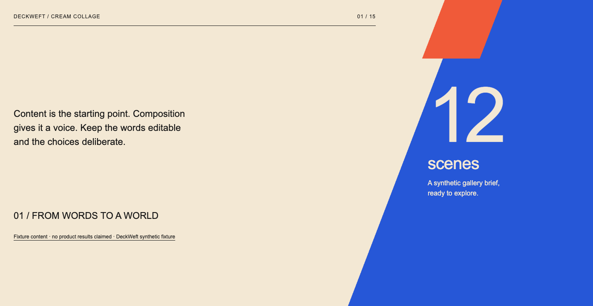
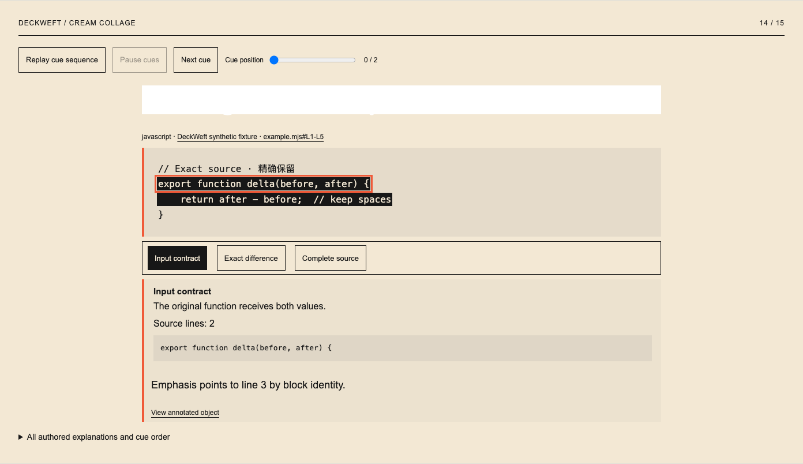
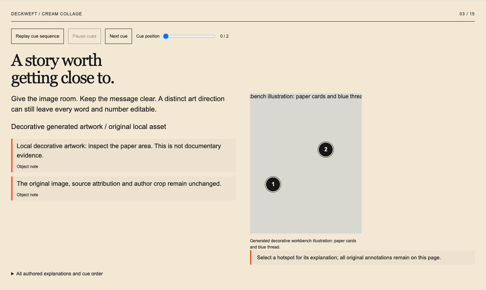
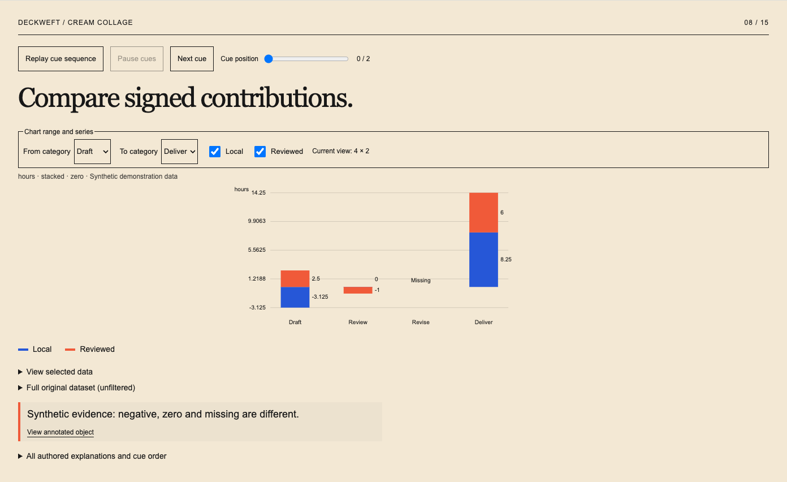
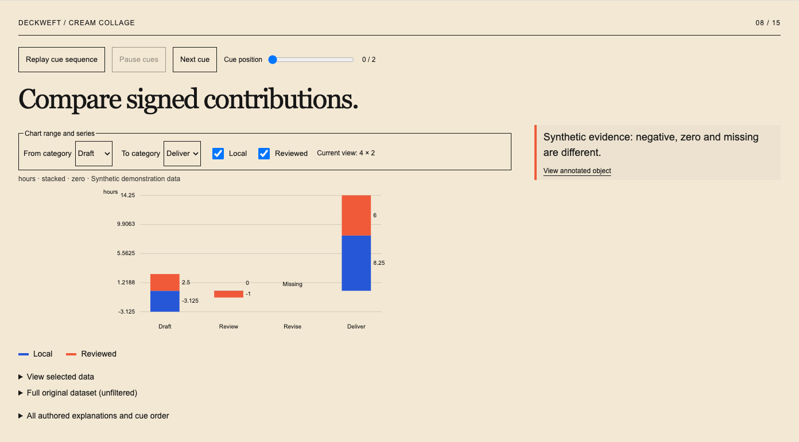
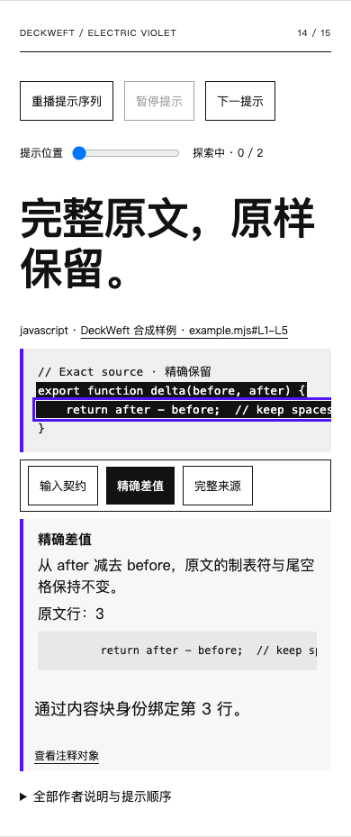
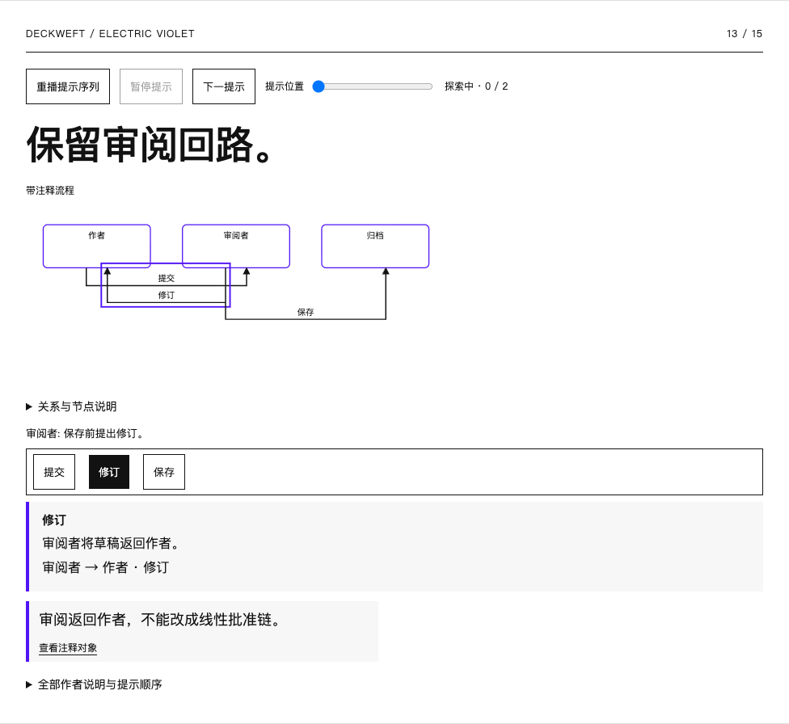

# VIS-010 — browser quality and bounded correction, 2026-10-18

[Manual](../../en/visual-quality.md) · [简体中文说明](../../zh-CN/visual-quality.md) · [Summary](review.json) · [Full browser diagnostics](browser.json) · [Actual image judgments](image-reviews.json)

The representative local quality gate passed after machine checks **and actual image input**. Chrome for Testing 151.0.7922.34 ran from the cached isolated installation outside `/Applications`, with ephemeral contexts and loopback requests only. Installed apps and personal profiles were untouched. No runtime dependency, remote provider or automatic image request was added.

Six complete 15-scene stories retain the original cover/evidence/chapter themes while the interactive scenes cover Cream Collage, Dark Data and Electric Violet in English and Simplified Chinese. Each ran at 1440, 1024 and 390 CSS pixels: **234 real action traces**, **1,872 region coverage records**, actual platform font reports and image readiness. Captures include 90 native scene PNGs, 18 explored full-page PNGs, 18 native explored component PNGs and six contact sheets. Full files and runnable source-preserving HTML remain in `dist/visual-quality`; this evidence folder retains the reviewed subset. The full browser JSON retains all screenshot hashes, diagnostics, source/plan snapshots, budgets and trace observations.

The [22-check Visual Studio regression](studio-regression.txt) also passed, retaining exact-source editing, author locks, v1/v2 migration paths, conflicts, save/reload and history restore-as-copy. [Final verification log](verify.txt) records **279 passing tests**, types, source checks, reproducible packaging and all demos.

The reviewing model actually received pixels for 48 distinct QA screenshot paths (with repeat delivery after recapture): six contact sheets, six explored complete-deck views, 24 native components, three fault scenes, the repair before/after pair, one failed complete candidate and six native responsive-state components. `image-reviews.json` names the 36 receipt-required images, delivery method, substantive per-story judgments and warnings. The complete-deck image viewer downscaled long pages; those views establish order/rhythm, while native component images establish text and detail. No claim is made that every native scene or possible audience state was visually read at full scale.

Observed failures and scoped correction:

| Trigger | Appropriate check and actual observation | Result |
| --- | --- | --- |
| A heading has 1px height and hidden overflow | `clipping`; the title disappears while the remaining cover stays visible | Detected, original source unchanged |
| White text on white background | `contrast`; a blank white title band appears on the code page | Detected |
| Invalid local image bytes | `missing-asset`; the original-image rectangle shows a broken placeholder and alt text | Detected without network fallback |
| Six adjacent evidence pages share the same composition | `repeated-composition`; whole-story sheets show the repeated rhythm | Each story changes only `component-stacked`, from `evidence-top` to `evidence-left` |
| A click listener prevents the explanation handler | `broken-interaction`; real click leaves the original step selected and fails its semantic postcondition | Detected, trace retained |

The five fault types are in `browser.json` with scene/region/block identities, document-pixel bounds, severity, reason and suggestion. Global/missing geometry records use explicit null bounds. The injected dead listener is verified by action/state/explanation checks; a static screenshot alone cannot establish that a button is dead.

All six ordinary repair runs accepted **one measured candidate, one scene change and one round**, under their explicit default budgets: two rounds, six candidates, two accepted scene changes and 60 seconds per story. Late/incomplete evaluations cannot promote output. Scope validation and author locks run before rendering. The document, exact numbers, citations, assets, crops, identities, interactions and unrelated scenes remain unchanged.

A separate [real browser recovery probe](failure-recovery.json) measures an author-locked repeated plan. Both automatic rounds reject the scoped change; no locked candidate reaches evaluation. The last valid HTML remains byte-identical, and the complete failed project/HTML are retained. It also confirms that a real explanation change invalidates the earlier receipt. [Probe log](recovery-log.txt). The main controller additionally tests budget exhaustion, thrown/incomplete/never-settling evaluators and source/layout/state/viewport/renderer/image changes. Artifact tests preserve the last accepted source/bytes through consecutive failures and pending image reviews, and reject altered accepted files. Source coverage tests require actual decoded links, including query ampersands, rather than the appearance of a URL in source JSON. An actual [stale-review refusal](stale-review-refusal.txt) rejected an earlier source fingerprint before any review write. The CLI refuses stale source/output/image reviews; source-preserving project-file runs also bind the current input file.

Visual judgments: the six story sheets keep the bold collage cover, saturated chapter break, exact evidence sequence, code/source ending and original-image comparison. The repaired stacked chart has a clear evidence rail while retaining every category and signed value. Native code remains readable, selected crop/hotspot emphasis is clear, and English/Chinese hierarchy and source labels stay visible. Dark Data retains light labels and lime/purple separation; Cream keeps serif headings with coral/blue accents; Electric Violet keeps a white evidence surface and strong chapter contrast.

The [supplementary state probe](responsive-states.json) exercises actual series deselection, code calculation and process return-path selection at 390/1024px and confirms unchanged runtime source. Native screenshots were actually inspected. At 390px, code, charts and diagrams use horizontal scrolling with complete source alternatives; they do not display every original glyph simultaneously. This is retained rather than shrinking type or deleting content. The filtered missing label lies close to the zero-axis tick: a nonblocking visual warning is recorded per story, with stable region bounds and a scoped spacing recommendation. Finer rhythm similarity, scroll affordances and arbitrary state/label collisions remain later work.

The initial temporary-folder run exposed macOS `/tmp` symlink rejection; resolving the new test folder to its real path fixed the harness without loosening storage validation. An early repeated-width action falsely expected a toggled hotspot to stay open; each width now starts with a fresh output, and native semantic postconditions remain mandatory. The image viewer downscales long pages and made the presence of the shared cover hard to judge in repeated image outputs. Native PNG dimensions and pixel probes confirmed that the covers are present. The capture helper now explicitly returns to the document start and waits two animation frames for reproducible full-page capture; all six final complete stories were delivered again for visual review. Thirty unchanged contact/component images reuse the previously delivered actual pixel reviews, with byte identity checked before rebinding new receipts. These harness failures were retained as observations rather than relabelled as product passes.

PowerPoint, Keynote and Figma are installed but were not run for this revision. After Effects was not available in `/Applications`. Other engines, actual screen readers, IME, 200% zoom, native v3 exports, remote CI and broader host/release gates remain open. `release-gallery` is this representative local case name, not completion of VIS-014.

To explore locally, run `npm run visual:review` and open the loopback address. The gallery links all six live outputs, full-size captures, faults and structured diagnostics. The command `npm run visual:verify -- --help` describes independent test-browser setup and explicit review submission.
