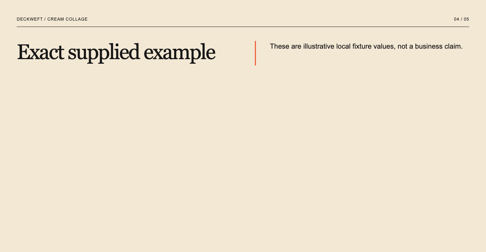
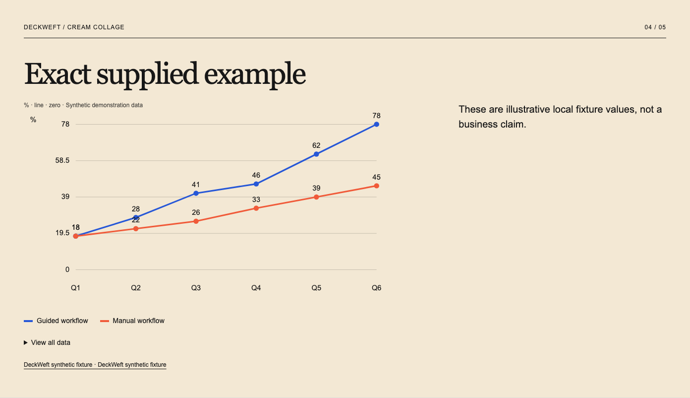
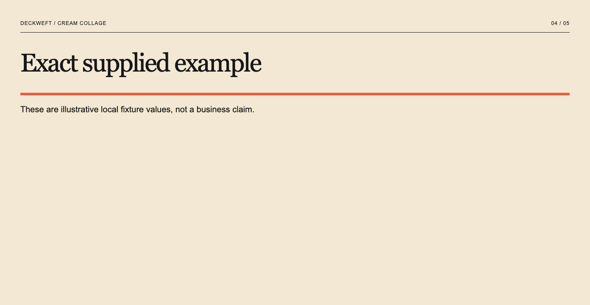
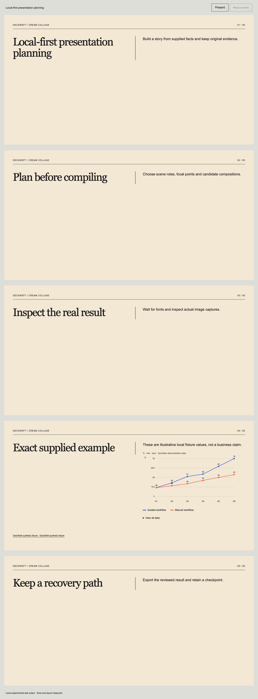

# VIS-011 — one local presentation task, 2026-10-18

[Manual](../../en/task-loop.md) · [简体中文](../../zh-CN/task-loop.md) · [Summary](review.json) · [Real browser report](browser.json) · [Actual pixel judgments](image-reviews.json) · [Final exports](final.json) · [Accepted-artifact recovery](accepted-recovery.json)

Implemented locally: the storyboard entry point, task-specific design director, seven shared tools, durable checkpoints, existing agent bridge and MCP now use the same source-preserving task controller. Story roles, focal identities, family candidates, color modes and local asset requirements exist before compilation. Only relevant selected theme tokens/rules enter the brief. No runtime dependency, remote service, automatic image request, model change, separately billed API, installed browser modification, publication or push was introduced. Existing workspace changes were retained.

`npm run verify` passed **290 tests**, types, source checks, reproducible packaging and demos. [Full log](verify.txt). The existing [22-check bilingual Visual Studio browser regression](studio-regression.txt) also passed, covering locks, measured exports, v1/v2 migration, stale saves, history and restore-as-copy.

The [actual local integration](browser-log.txt) used cached isolated Chrome Headless Shell **153.0.8010.12**, outside `/Applications`, with temporary contexts and loopback-only requests. It formed a five-page complete supplied-language story, measured all pages at **1440/390px**, and captured native fourth pages. The source, browser snapshots, full failed candidates, recovery task JSON and runnable HTML remain in `dist/visual-task`. No page errors or external requests were observed. This is local orchestration, not an authenticated host/model run.

The reviewing model received **13 final distinct image paths** through `functions.view_image`: desktop/mobile full stories and native fourth pages for the original, precise revision, successful repair and locked failure, plus the actual failed rerun after accepted export. Tall desktop screenshots were downscaled by the viewer; native fourth pages established detail. Three explicit judgments were bound to current receipt IDs, captured PNG SHA-256 bytes, HTML, source, audience observations and renderer/contracts/themes. All three final HTML exports passed the same tool dispatcher. [Export log](export-log.txt). No mock image attestation is represented as actual review.

The precise Chinese request “把第 4 页改成图表，保持原文和颜色” selected an original typed dataset explicitly. Only that scene gained a chart and its original citation. All prior blocks, exact numbers, sources, theme/colors, focal identity and all other scene objects were compared unchanged. No original dataset means `DATA_REQUIRED`, with original and recovery JSON retained; no prose/metric-string conversion or invented data. The demo dataset is labelled synthetic, not a business claim. Offline content checks preserve references and identify unverified claims; they do **not** claim external factual verification.

An actual repeated-layout run accepted **one candidate, one changed scene and one round**, under the shared default **2 rounds / 6 candidates / 2 accepted scene changes / 60 seconds** budget. Page 4 changed from split to banner, preserving words and palette. A locked run rejected all four proposed candidates in two rounds before evaluation. A subsequent [real failure after an accepted export](accepted-recovery.json) used the one-task runner with a real browser capture capability: only the initial failed render ran, locked candidates never reached rendering, and the accepted source/HTML stayed byte-identical. The recovery checkpoint retains the incomplete source, diagnoses, spent budget, original, history and `lastValid`.

The controller's eleven new tests use explicitly synthetic capture/review callbacks for scope, revisions, author locks, pending/changed receipts, missing assets, budget exhaustion, visual feedback repair, durable bridge checkpoints, MCP tool advertisement and old-completion bypass refusal. Existing real MCP stdio subprocess tests remain part of `npm run verify`; they are local protocol tests with fixture workers. They do not demonstrate VIS-012 native desktop discovery or real model execution. CLI creation was also actually run with the Chinese example; it produced a five-page preview-ready task without calling a model.

Observed and corrected during this work: a multi-series input initially selected a single-series ranked bar; chart creation now selects a compatible line representation. Missing-resource resolution initially returned an empty map as success; it now blocks explicitly. The first real revised render found absent visible source links; the scoped chart addition now includes its original dataset citations. These failed checks preceded the final captures and remain described here rather than being called passes.

Visual judgments and limits: the cream/coral story has readable hierarchy and consistent supplied wording at both widths, with spacious desktop layouts. Native page 4 retains two original series, category labels, exact values, the source link and disclaimer. At 390px the chart uses the existing horizontal scroller and full-data disclosure; all original categories are not simultaneously visible. The shared initial `18` label overlaps, and citation text repeats its source title. These are nonblocking visual warnings. The minimal repair interrupts repetition but is not a complete editorial redesign. Arbitrary requests need host-authored outlines/structured scope; the local chart grammar is intentionally narrow. Short single-page inputs use three views of the same supplied text rather than inventing a story's facts.

PowerPoint, Keynote and Figma were installed but were not run. After Effects was not available in `/Applications`. Native v3 exporters, other engines, real screen readers/IME/200% zoom, remote CI, VIS-012 host adapters and VIS-013 workbench remain open.

Run `npm run deck:review` and open its loopback address for original/revised/repaired HTML, failure diagnostics and last valid output. To create your own checkpoint: `npm run deck:create -- --brief examples/task-brief.en.json --out dist/my-task`. Use a new output folder; see the manual to supply real capture and image review capabilities. Reproduce actual QA with the two explicit QA environment paths and `npm run deck:verify`; inspect its new images before submitting new judgments with `node scripts/review-task.mjs --reviews review.json`. Old receipt IDs cannot be reused after recapture.
