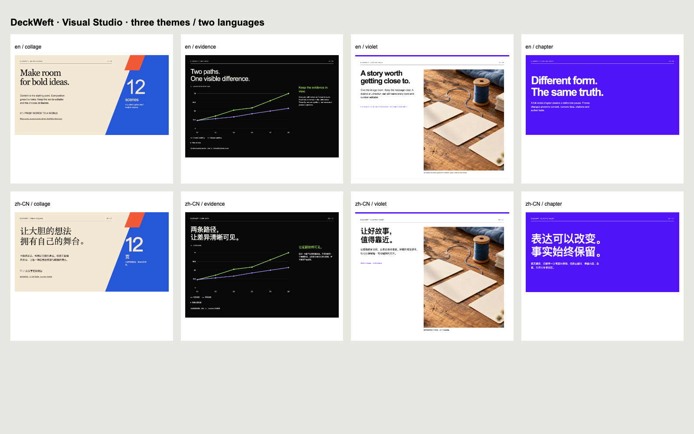
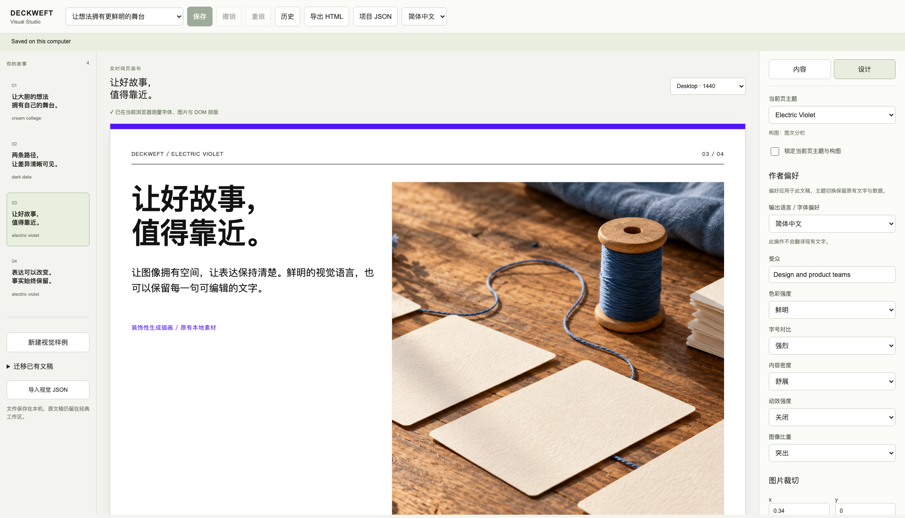
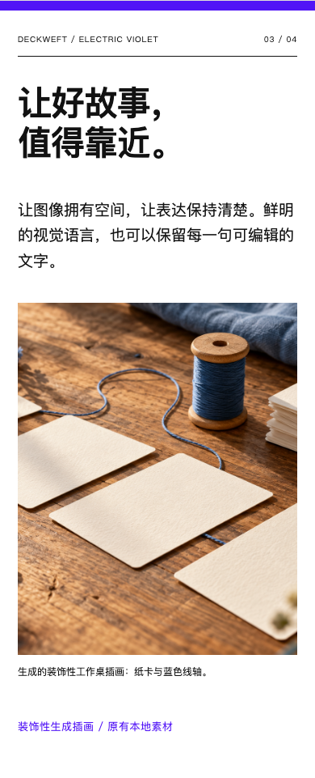

# Visual Studio implementation review — 2026-10-18

[English manual](../../en/visual-studio.md) · [简体中文手册](../../zh-CN/visual-studio.md) · [Machine review](review.json) · [Browser evidence](browser.json) · [Source fingerprint](source.json)

The user requested continued VIS-002–005 implementation, Studio integration, Electric Violet, verification and a visible result. Work extends the earlier uncommitted Wave A slice on local `main`, starting at `9204f21161fd5b5c15c4040bd2414bed55fb4d99`. The supplied roadmap is unchanged. No commit, push, release or remote workflow was created.

## Delivered behavior

Visual Studio is a working `/visual` route in the same loopback application, linked below the classic library selector. It edits semantic content, exact numeric datasets, source references/anchors, scoped theme choices, author preferences and normalized image crops. It saves, reopens, detects stale revisions, keeps edits made during a save, shows immutable history and restores a separate copy. Both stores share atomic/revision/history code; their schemas and library paths remain distinct.

The persisted `deckweft-visual-project` envelope contains a v3 semantic document, v1 design plan, local asset manifest, revisions and extension metadata. Sources can carry version/hash/permission/anchor records. Import validates before assigning a new identity. V1/v2 migration preserves the full original and its hash, explicitly archives unsupported intent/private notes, keeps legacy metric strings as text and never rewrites the saved source.

The derived v1 WebScene includes stable block/data bindings, text roles, groups, reading order and responsive variants, bounded SVG paths/transforms/clipping/gradients and image crops. Invalid path commands and missing bindings fail validation. No executable imported markup is accepted. V3 native output still reports a target-specific unsupported result and does not prevent valid HTML output.

All three versioned theme packs are executable and packaged: Cream Collage, Dark Data and Electric Violet. They include English/Chinese typography, spacing, image grammar, series colors, modes, motion and scoped rules. Role/mode specificity resolves conflicting preferences within the chosen pack. Author locks protect content/data/sources or scene decisions; the UI preserves them across theme changes. The core runtime has no new dependency and ships no fonts.

Electric Violet has an image split and a full-violet chapter, with white/black/violet hierarchy. The example reuses the original generated workbench illustration from MB-11–15 and identifies it as decorative generated artwork. It is not documentary photography. Local PNG replacement preserves the scene's crop, composition, datasets and unrelated choices; actual image bytes are hash-verified and embedded in standalone HTML. Repeated uses count toward resource budgets.

## Verification

`npm run verify` passed **240 tests**, with schema-derived type/negative-fixture checks, emitted-module smoke, source checks, reproducible plugin packaging and old/new language demos. [Final log](verify.txt). Nine new Node tests cover visual storage/history/restore, locks/data/source references, source/crop/ID validation, image integrity and repeated-use budgets, scoped theme rules, graphics contracts, API security, strict imports, unsupported targets and stale export gates. Earlier v1/v2 and Wave A tests remain passing. The first full run exposed a historical capsule fixture that still expected only MB-01–15; its exact expected authorization list now includes the requested VIS-001–005 and explicitly excludes the planned VIS-006. No job grant was widened by that test adjustment.

`npm run visual:render -- --case studio --locale all` ran twice and produced identical source/output/render hashes. The new example is also part of `npm run demo`. [Render manifest](render-manifest.json).

`tests/browser_visual_studio.mjs` ran against a real local Studio with an isolated cached Chromium **151.0.7922.34**, ephemeral contexts and exported CSP enforcement. Its **22 check entries** include actual edit/save/reopen flows, content and scene locks, theme changes without fact loss, numeric plot/table updates, invalid JSON retention, in-flight saves, two real tabs with revision conflict, read-only history/restore-as-copy, profile/crop/language persistence, local PNG replacement, legacy migration, HTML download, responsive editing and no-JavaScript reading. It records **0 page errors** and **0 external requests**. Expected revision-conflict HTTP errors are deliberate tests, not hidden failures.

English and Chinese four-scene artifacts were captured at **390, 1024 and 1440 CSS px**. The retained **31 PNGs** include 24 scene captures, Studio views and a contact sheet. Captures wait for fonts/images and include DOM/contrast/clipping results, actual Chromium platform-font evidence, source/render/output/screenshot hashes and viewport data. Negative browser cases deliberately inserted white-on-white text and a clipped heading; both returned the affected region IDs and failed their fit check. These are browser-reported checks, not independent aesthetic/accessibility certification.

The source tree fingerprint identifies the exact uncommitted implementation. The browser report includes exact exported artifact hashes; large generated HTML stays under `dist/visual-studio/acceptance/` or `dist/visual/studio/`, not in source fixtures. The built-in illustration is approximately 2.4 MiB; the self-contained example exceeds the proposed 2 MB initial-payload target. Optimization and lazy loading remain asset-pipeline work.

## Visual inspection and repairs

The agent received actual screenshot pixels through the image tool. Inspected views include both languages' Electric Violet pages, full-violet chapters, mobile reflow, editor/theme/crop controls, and the contact sheet covering all three systems. Cream Collage retains diagonal geometry and serif type, Dark Data retains numeric charts/evidence rails, and Electric Violet adds large image-led geometry and a distinct chapter pause.

Browser work exposed and corrected four integration defects: crop source bounds were treated as visible overflow; visible serif glyph overhang was incorrectly treated as clipping; controls initially appeared enabled before bootstrap completed; and the mobile scene rail forced a grid wider than the viewport. Embedded previews also now keep the selected scene when switching to a narrow viewport. Actual clipping/contrast checks were added with negative cases rather than suppressing the fit gate.

## Task accounting and remaining gates

VIS-002–005 are recorded as **implemented-local** for their initial versioned contracts and local acceptance: semantic copy/storage/strictness; derived target protocol; bilingual semantic rendering and DOM measurements; and three executable themes with scoped author choices. This does not close the later visual release gate or certify all future compositions.

VIS-001 retains its remote-CI gate. VIS-006 is next: meaningful composition candidates and full-deck rhythm. The complete 12-page gallery, coherent eight-page stories, additional chart/diagram layouts, general bounded visual correction, prompt generation/host receipts, JPEG/WebP/subject-aware asset selection and v3 native export remain later roadmap work. There is no built-in model provider, new external connector, background upload or subscription inference.

PowerPoint, Keynote and Figma were found on disk but were not launched for this HTML/Studio batch. After Effects was not found in the checked application directories. [Application availability](app-availability.json). Real OS IME, screen reader, 200% zoom, other browser engines, projection and remote CI were not tested. LICENSE and NOTICE.md remain unchanged; installed browser bundles and personal profiles were not modified.
