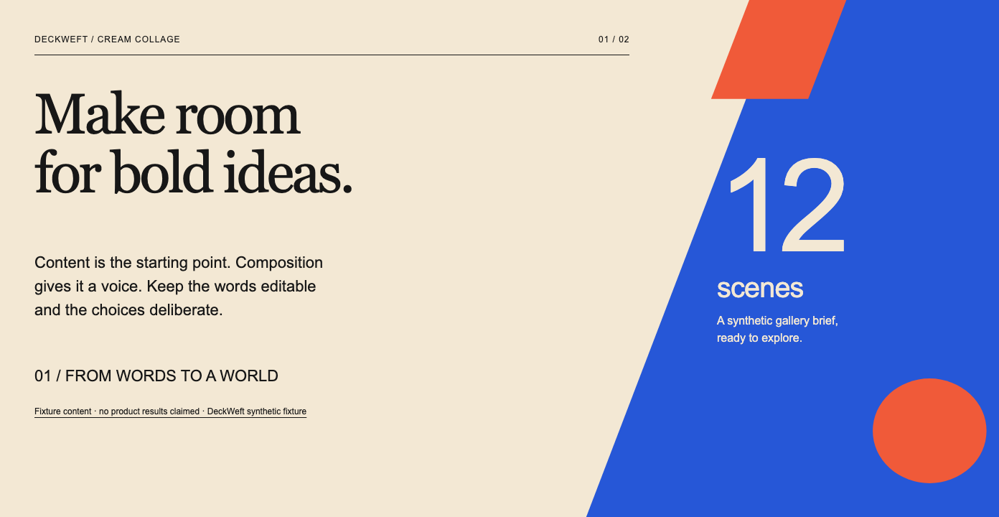
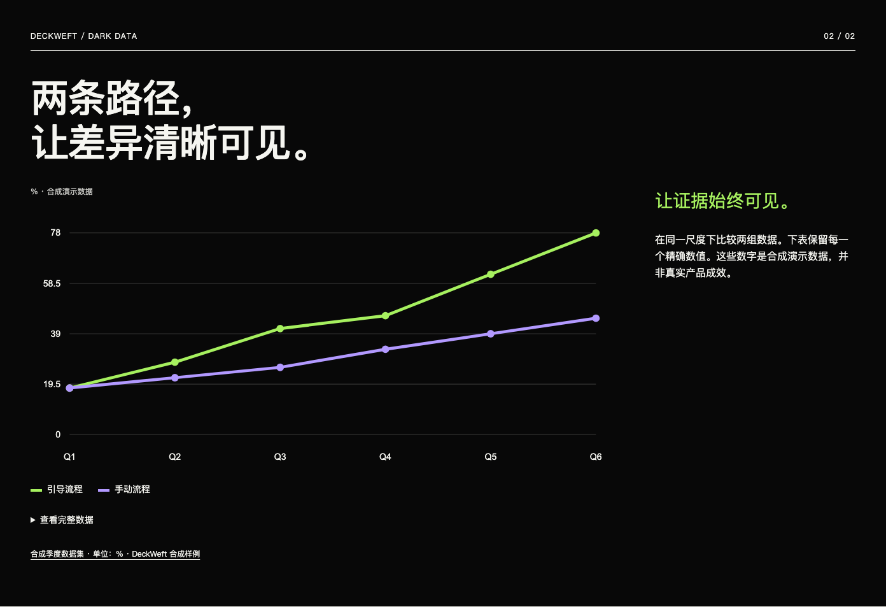
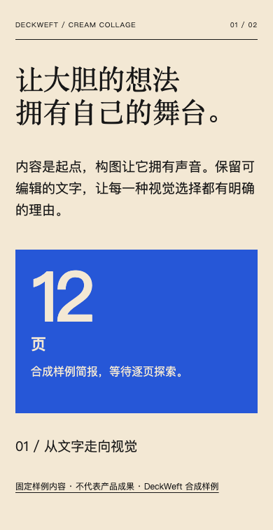
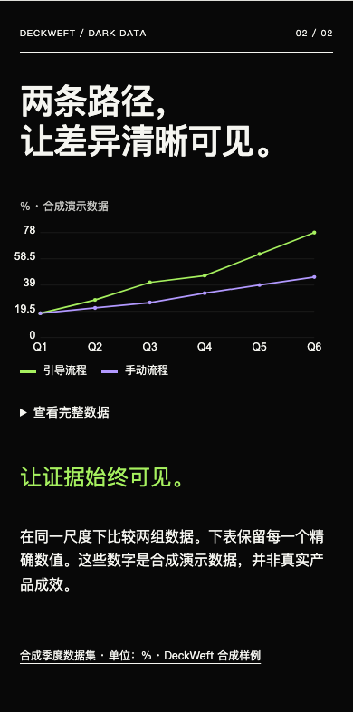

# Wave A implementation review — 2026-10-18

[English guide](../../en/visual-first.md) · [简体中文](../../zh-CN/visual-first.md) · [Machine review](review.json) · [Capture/environment manifest](../../visual-baseline/capture-manifest.json)

Starting source commit: `9204f21161fd5b5c15c4040bd2414bed55fb4d99`, local branch `main`, matching the supplied roadmap's audited DeckWeft revision. The working tree initially contained only the user's untracked roadmap. It was read and left unchanged. The implementation is an uncommitted working-tree slice; the capture manifest records source file hashes and a source-tree fingerprint. No repository, release, package or tag was published or pushed.

## What is implemented locally

CI installs the locked development compiler with `npm ci` before verification. Three frozen legacy baseline decks render reproducibly and match the pristine audited renderer byte for byte. New closed semantic, design-plan and WebScene schemas drive runtime validation and generated TypeScript declarations. A copy adapter validates v1/v2 first, preserves complete originals and source hashes, keeps legacy string metrics as text, and never saves into the existing library.

Experimental HTML export compiles stable block bindings to semantic DOM, diagonal SVG artwork or numeric SVG charts with exact data tables. English and Chinese have distinct resolved font preferences. The two versioned theme token subsets visibly differ in geometry and hierarchy. HTML renders public bound blocks only; source archives/private notes stay out. JSON is the explicit complete-data export. Image resolution and v3 native compilers fail honestly instead of flattening the page.

Modules changed: `.github/workflows/ci.yml`; shared bounded schema validation; `src/core/blocks.mjs` and `src/core/adapters/legacy-project.mjs`; `src/design/`; `src/scene/web/`; `src/targets/`; `src/render/export.mjs` and `src/render/web/`; schema-derived types; fixed visual fixtures, scripts and regression tests. No runtime dependency was added. LICENSE and NOTICE.md are unchanged.

Contract versions: presentation schema 3 (`deckweft-presentation`), design plan 1, WebScene 1, theme token subsets 1.0.0, renderer `wave-a.1`. The existing Studio ProjectStore remains v1/v2. New documents are explicitly experimental; they do not silently migrate or replace saved projects.

## Actual commands and checks

- `npm ci`: installed the single locked development dependency successfully.
- `npm run verify`: **231 tests passed, 0 failed, 0 skipped**, plus generated type/negative-fixture/emitted checks, source validation, reproducible plugin packaging and all existing demos. [Final log](verify.txt).
- `node --test tests/visual-web.test.mjs`: nine new regression tests cover typed data round trips, invalid fields/references/URLs/numbers, explicit migration, private-note omission, stable scene IDs, missing content, native target refusal and revision conflicts. An initial test used macOS's symlinked temporary path and was corrected to resolve the real temporary directory, retaining the storage symlink guard.
- `npm run doctor`: actual CLI version probes, authentication explicitly **not checked**. [Output](doctor.txt).
- `npm run visual:baseline` and `npm run visual:render`: deterministic HTML and input/output/render hashes in `dist/visual/`.
- Pristine Git archive comparison: original and current legacy renderer outputs match for all three frozen fixtures. [Result](../../visual-baseline/pristine-comparison.json).
- `npm run visual:capture` with an explicit cached Chrome for Testing headless shell and external Playwright QA module: **9 cases** (3 baseline captures, 6 bilingual viewport cases), **0 page errors**, **0 external requests**. Direct loopback, production exported CSP active. No installed browser bundle or personal profile was modified.

Browser: Chromium **151.0.7922.34**, macOS arm64, Node **v24.14.0**. Wave A widths: **390, 1024, 1440 CSS px**, height 1000. Capture waited for `document.fonts.ready` and image decode. Actual platform fonts included Georgia/Arial for English and Songti SC/PingFang SC/Arial for Chinese. DOM fit results, font probes, platform font glyph counts and source/output/render/screenshot/browser/viewport-state fingerprints are retained in the manifest. Fit measurements and screenshots refer to the same exported render hash. This is one browser/font environment, not every-browser or accessibility certification.

The browser exercised mouse and Enter disclosure, exact six-row data tables, reading/presentation navigation, no horizontal document overflow, and both language editions with JavaScript disabled. The plot is a genuine two-series dataset; Q6 stays **78 / 45**. No image generation, model run or remote research was needed.

## Screenshot inspection and correction

The agent received and inspected actual screenshot pixels through the image tool: all three two-page legacy baselines, both new scenes in both languages, and desktop/tablet/mobile layouts. The fixed legacy API/code sample visibly demonstrates its original plain-text limitation. The new cover and evidence pages have different silhouettes rather than a palette-only variation.

The first cover put cream metric text partly on the cream background. DOM bounds passed but the screenshot exposed poor contrast. The metric was moved to the blue safe region and its unit stacked beneath it. Mobile chart labels were too small; mobile and tablet label sizes were increased. Chinese mobile cover typography was reduced to prevent an isolated final character. Fresh captures confirm the corrected cover number, readable chart labels and retained citations. No aesthetic score or complete contrast certificate is claimed. The Chinese metric caption/evidence rail still has ordinary narrow-column wrapping; richer typography and contrast auditing remain follow-up work.

## Status and next work

**Completed local slice:** CI install step, baseline generation/capture, initial contracts/types, explicit legacy copy adapter, target gating, two bilingual web compositions, responsive/no-JS reading and measurement evidence. **No complete VIS task is marked done:** VIS-001–005 stay `partial` against the full roadmap acceptance.

VIS-001 still needs a successful remote CI run; none was triggered. VIS-002 needs complete source snapshots, richer overrides and revisioned v3 Studio integration. VIS-003 needs full graphic/crop/breakpoint/interaction protocols. VIS-004 needs broader measured layout and bounded correction/contrast coverage. VIS-005 needs Electric Violet, complete tokens/rules and author profiles. These are the next ready work items on the frozen initial contracts. The full gallery and composition-candidate task VIS-006 depend on finishing that foundation. Host integration, source synchronization and native export gates remain open.

PowerPoint, Keynote and Figma were found on disk but not launched or tested in this batch. After Effects was not found in the checked application directories. [Availability evidence](app-availability.json). No Codex/Claude generation task, native application import, real IME, screen reader, 200% zoom, projection or remote CI acceptance is claimed.
