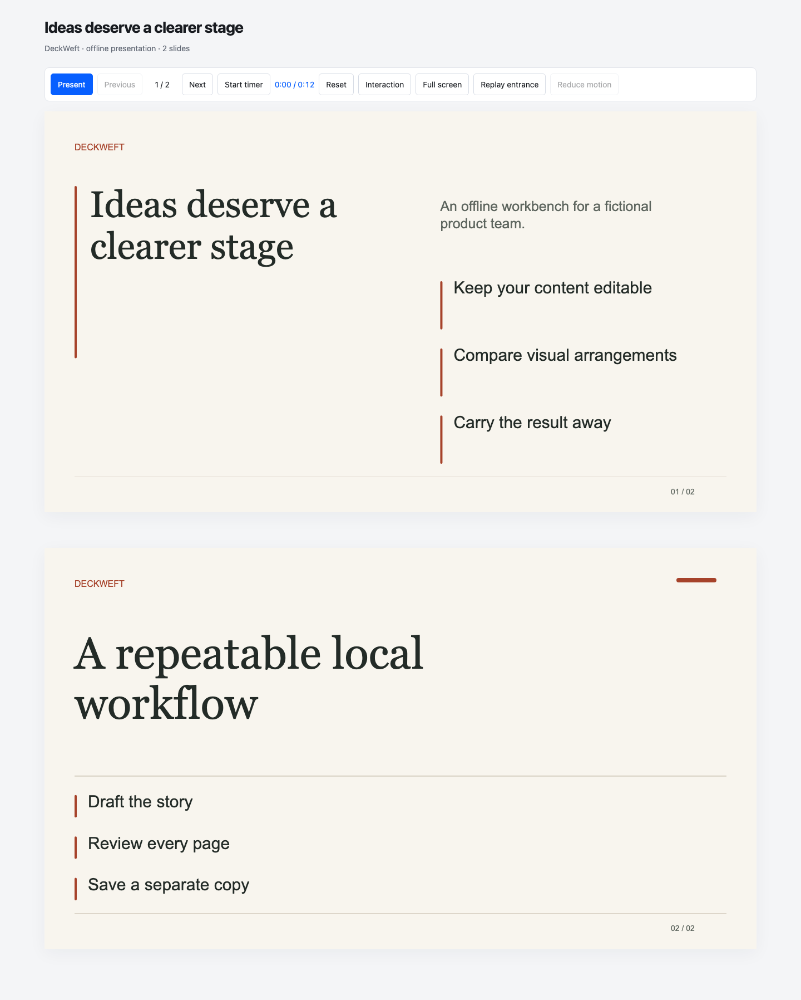
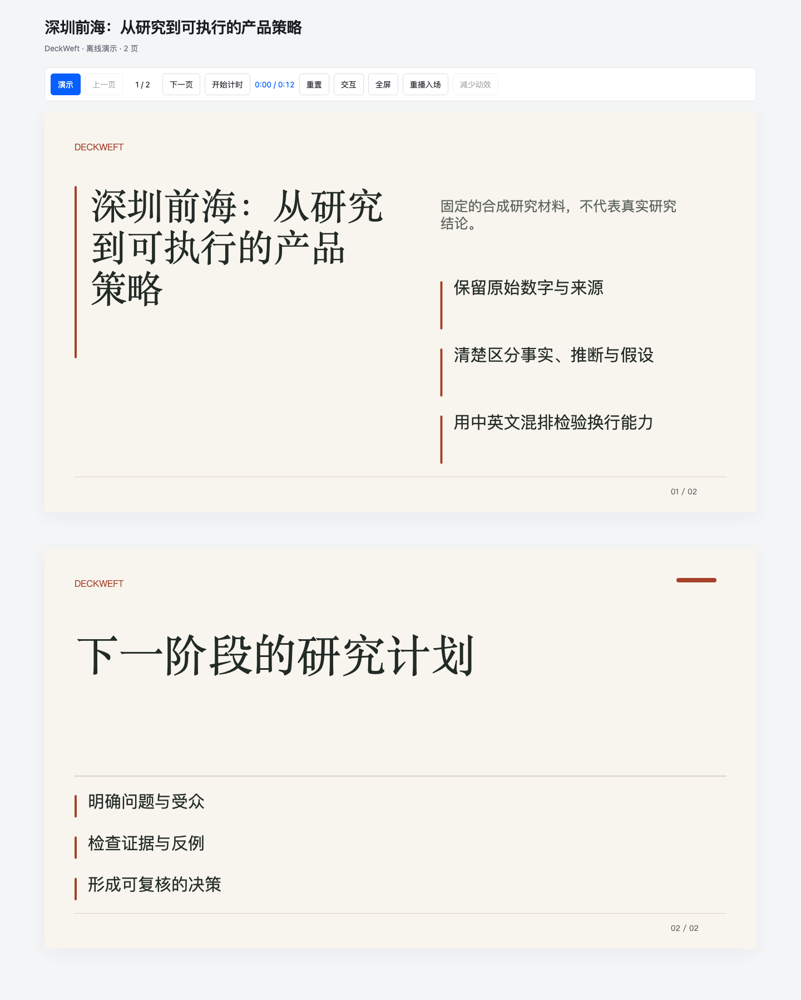
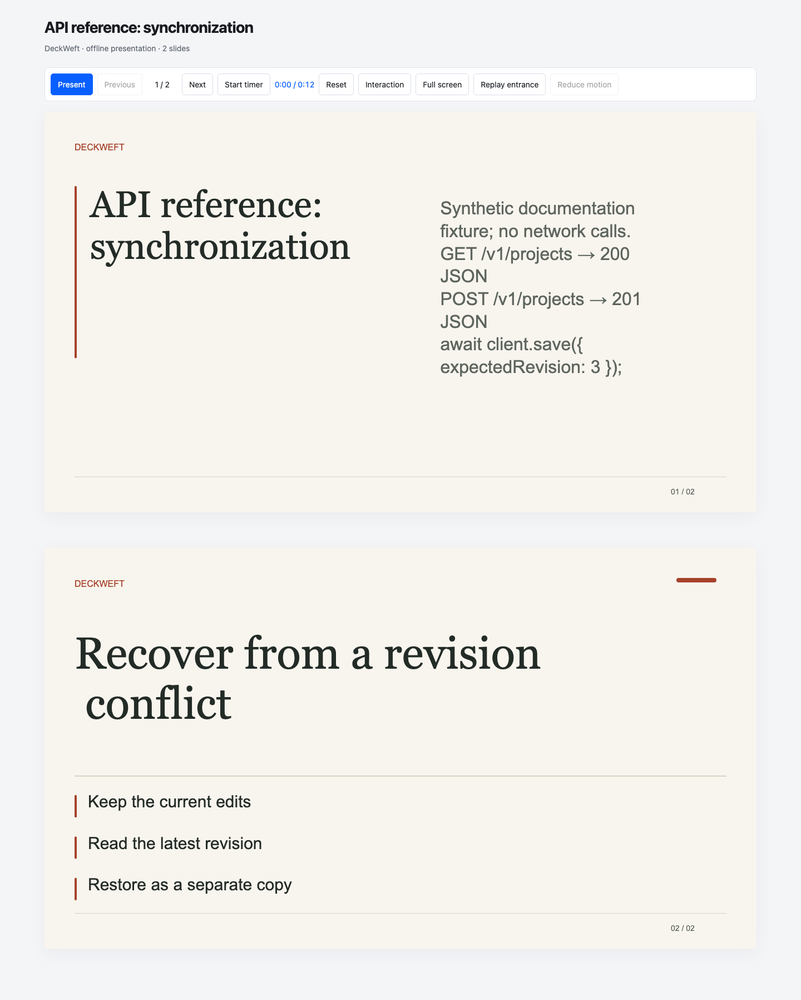

# Frozen legacy renderer baseline

[Wave A guide](../en/visual-first.md) · [Review](../evidence/visual-wave-a/review.md)

The fixed inputs live in `tests/fixtures/visual/`: English product narrative, Chinese strategy/research, and technical API/code content. They are synthetic examples, not product research or performance claims. Each deck has two pages.

Run `npm run visual:baseline` for deterministic legacy HTML. Run the optional `npm run visual:capture` with isolated QA tools for screenshots after font/image readiness. Build artifacts belong under `dist/visual/`; reviewed baseline screenshots and the captured environment manifest are retained here.

[Pristine comparison](pristine-comparison.json) records exact HTML equality against an independently extracted Git archive of `9204f21161fd5b5c15c4040bd2414bed55fb4d99`. The current source is an uncommitted rebuild slice on top of that commit; the baseline is not claimed to be a remote CI run.

[Environment and font evidence](capture-manifest.json) contains all three baselines and both new language editions at three widths. Screenshot hashes bind the reviewed files to the capture. CSS font preferences are recorded for the legacy SVG baseline; actual Chromium platform fonts are additionally recorded for the new semantic DOM path.

